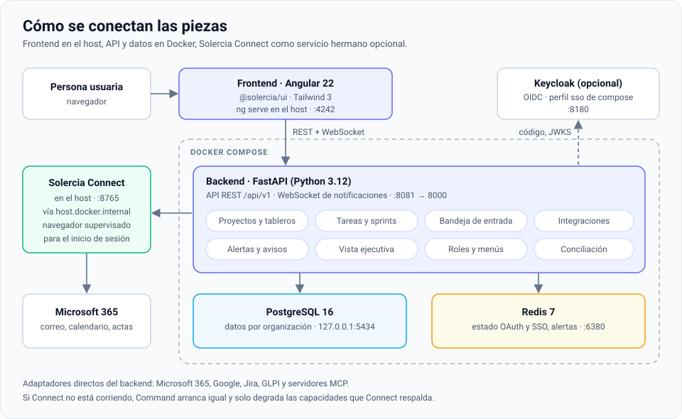
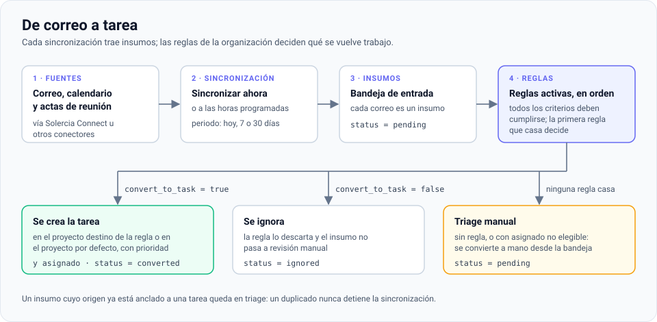
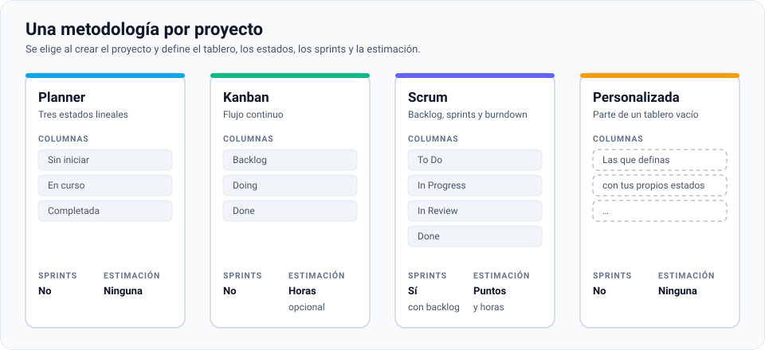
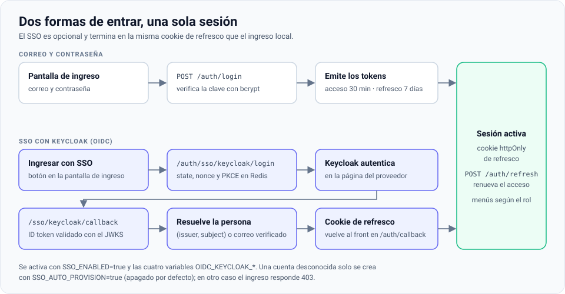

<div align="center">

# Solercia Command

**Centro operativo de trabajo multi-tenant: proyectos, tareas, alertas y bandeja de entrada en un solo lugar.**

Puede reemplazar a Jira y Microsoft Planner. Cada proyecto elige su metodología y convierte tu correo en trabajo con reglas, sin copiar y pegar.

[](LICENSE)
[](frontend/package.json)
[](backend/requirements.txt)
[](backend/Dockerfile)
[](docker-compose.yml)
[](docker-compose.yml)

</div>

---

## Contenido

- [Cómo funciona](#cómo-funciona)
- [Funcionalidades](#funcionalidades)
- [Quickstart de desarrollo local](#quickstart-de-desarrollo-local)
- [Inicio de sesión con SSO (Keycloak)](#inicio-de-sesión-con-sso-keycloak)
- [Configuración](#configuración)
- [Arquitectura y documentación](#arquitectura-y-documentación)
- [Contribuir](#contribuir)
- [Licencia](#licencia)

## Cómo funciona

### Las piezas

<p align="center">
  
</p>

- El **frontend** (Angular 22 con la librería de componentes `@solercia/ui`) corre en tu equipo con `ng serve` en el puerto 4242.
- El **backend** (FastAPI, Python 3.12) expone la API en `/api/v1` y un WebSocket para las notificaciones en tiempo real. Sigue capas `router → service → repository` y separa los datos por organización con la columna `organization_id`.
- **PostgreSQL 16** guarda los datos y **Redis 7** el estado de corta vida: `state` y `nonce` del SSO, estado de OAuth de las integraciones y alertas.
- **Solercia Connect** es un servicio hermano que corre en el host, fuera de Docker. Abre un navegador supervisado para que inicies sesión en Microsoft 365 y lee correo, calendario y actas de reunión. Command nunca recibe ni guarda tu contraseña. Si Connect no está corriendo, Command arranca igual.

### De correo a tarea

<p align="center">
  
</p>

Cada sincronización trae insumos a la bandeja de entrada (`GET /api/v1/intake/items`). Las reglas de la organización (`POST /api/v1/intake/rules`) se evalúan en orden y la primera que casa decide:

- con `convert_to_task=true`, crea la tarea en el proyecto destino de la regla, o en el proyecto por defecto, con la prioridad y el asignado que defina;
- con `convert_to_task=false`, marca el insumo como `ignored`;
- si ninguna regla casa, o el asignado no pertenece a la organización, el insumo queda en `pending` para convertirlo a mano.

Sin reglas activas, todo queda en `pending`.

### Una metodología por proyecto

<p align="center">
  
</p>

La metodología se elige al crear el proyecto y es una estrategia del backend: define las columnas iniciales del tablero, los estados permitidos, si hay backlog y sprints, y cómo se estima. En el tablero, el estado de una tarea es su columna.

### Dos formas de entrar

<p align="center">
  
</p>

El ingreso local usa correo y contraseña. El SSO con Keycloak (OIDC) es opcional y termina en la misma sesión. Detalle en [Inicio de sesión con SSO](#inicio-de-sesión-con-sso-keycloak).

## Funcionalidades

| Área | Qué incluye |
|---|---|
| Proyectos y tableros | Metodologías Planner, Kanban, Scrum y Personalizada; tablero con arrastrar y soltar; jerarquía de proyectos y equipos; calendario laboral por proyecto |
| Tareas | Comentarios, adjuntos, etiquetas, listas de chequeo, vínculos entre tareas, registro de tiempo e historial de actividad |
| Sprints | Backlog, sprints y burndown en los proyectos Scrum |
| Seguimiento | Vista ejecutiva, rendimiento por colaborador y cruce entre lo asignado y lo realizado |
| Alertas y avisos | Tareas vencidas, en riesgo o bloqueadas, sprints en riesgo, carga desbalanceada y licencias por vencer; recordatorios y notificaciones en tiempo real |
| Bandeja de entrada | Insumos desde Solercia Connect, reglas de conversión a tareas, triage manual y sincronización programada |
| Conciliación | Propone avances de tareas a partir de hilos de correo; nunca los aplica sin que alguien los acepte |
| Integraciones | Solercia Connect, Microsoft 365, Google, importación desde Jira (API o archivo CSV/XLSX), sincronización con GLPI y servidores MCP; credenciales cifradas en reposo |
| Administración | Usuarios, roles, menús por rol e inventario de activos con sus licencias |
| Acceso | Correo y contraseña con JWT y cookie `httpOnly`; SSO opcional con Keycloak (OIDC) |

## Quickstart de desarrollo local

Los pasos son deterministas: cada uno dice qué ejecutar y qué salida esperar. Si una verificación no coincide, detente y revisa [Problemas frecuentes](#problemas-frecuentes).

### 0. Requisitos (verifica antes de empezar)

```bash
docker info >/dev/null && echo "docker OK"            # Docker Desktop encendido
node -v                                                # v22.x (o >= 20)
ls ../solercia-connect/.venv/bin/solercia-connect-service   # Connect instalado
ls ../solercia-connect/.env.local                      # configuración de Connect
```

Si Connect no está instalado, en `../solercia-connect` ejecuta `make setup` y `make setup-browser` (instala Playwright y Chromium). `devtunnel` es opcional: solo sirve para abrir el frontend desde el celular.

### 1. Secretos (una sola vez)

Command necesita una llave para cifrar en reposo las credenciales de las integraciones. `docker compose` no arranca sin ella. Genera una para tu equipo:

```bash
printf 'INTEGRATIONS_FERNET_KEY=%s\n' "$(openssl rand -base64 32 | tr '+/' '-_')" >> .env
```

`env.example` muestra también cómo generarla con Python. Usa una llave distinta en cada ambiente: si la cambias, las conexiones guardadas (Jira, Connect, IA) se deben registrar de nuevo.

Command y Connect comparten además una clave local de API. Genera una y escríbela en los dos archivos, que están ignorados por git:

```bash
KEY=$(openssl rand -hex 32)
# Connect
printf 'SOLERCIA_CONNECT_API_KEY=%s\nSOLERCIA_CONNECT_BROWSER_FALLBACK=true\nSOLERCIA_CONNECT_HTTP_INTERACTIVE_LOGIN=true\n' "$KEY" >> ../solercia-connect/.env.local
# Command (raíz del repo; el compose la inyecta al backend)
printf 'SOLERCIA_CONNECT_API_KEY=%s\n' "$KEY" >> .env
chmod 600 .env ../solercia-connect/.env.local
```

Si ya existían esas líneas, edítalas en lugar de duplicarlas. Verifica que las claves coincidan y no estén vacías:

```bash
diff <(rg -o '^SOLERCIA_CONNECT_API_KEY=.*' .env) \
     <(rg -o '^SOLERCIA_CONNECT_API_KEY=.*' ../solercia-connect/.env.local) && echo "claves iguales"
```

Salida esperada: `claves iguales`.

### 2. Levantar Solercia Connect (en el host, fuera de Docker)

```bash
cd ../solercia-connect
mkdir -p .dev-logs
env -i HOME="$HOME" USER="$USER" SHELL=/bin/zsh LANG=en_US.UTF-8 \
  TMPDIR="$(getconf DARWIN_USER_TEMP_DIR)" \
  PATH=/opt/homebrew/bin:/usr/local/bin:/usr/bin:/bin \
  SOLERCIA_CONNECT_ENV_FILE="$PWD/.env.local" \
  nohup .venv/bin/solercia-connect-service > .dev-logs/service.log 2>&1 &
sleep 3
curl -s http://127.0.0.1:8765/v1/health
cd -
```

Salida esperada (lo importante es `"status":"ready"` e `"interactive_login":true`):

```json
{"schema":"solercia.connect/v1","ok":true,"operation":"health","status":"ready", ... "data":{"version":"0.4.0","bind_host":"127.0.0.1","interactive_login":true}, ...}
```

Se usa `env -i` con un `TMPDIR` explícito porque Chromium necesita un directorio temporal que exista durante toda la vida del proceso.

### 3. Levantar Command

```bash
./gestion.sh on
./gestion.sh status
```

Salida esperada de `status` (todas las líneas con ●):

```
● postgres — Up ... (healthy)
● redis — Up ...
● backend — Up ...
● front :4242 — HTTP 200 (PID ...)
● túnel devtunnel (PID ...)            ← solo si devtunnel está instalado y con sesión
● Solercia Connect :8765 — listo (login interactivo por HTTP: true)
```

Tras cambiar código del backend ejecuta `./gestion.sh rebuild`; el frontend se recarga solo.

### 4. Entrar

1. Abre http://localhost:4242 e inicia sesión con las [credenciales de demostración](#credenciales-de-demostración).
2. En el menú lateral, entra a **Conexiones**.

### 5. Primera conexión de Microsoft 365

1. Pulsa **Conectar Solercia Connect**.
2. Escribe tu correo institucional, deja **Outlook (correo y calendario)** y el interruptor **Inicio de sesión con navegador** activado, y pulsa **Conectar**.
3. La tarjeta aparece con el estado:
   - **Conectada**: ya existe una sesión de navegador vigente para esa cuenta.
   - **Requiere iniciar sesión**: pulsa **Iniciar sesión**. Se abre un Chromium de Connect en tu equipo; ingresa usuario, contraseña y segundo factor en la página de Microsoft. La tarjeta se actualiza sola y muestra «Sesión de Microsoft 365 activa para <correo>».

Command nunca recibe ni guarda tu contraseña: vive en el perfil de navegador de Connect.

### 6. Rutina diaria

1. Verifica que Connect responda (`./gestion.sh status` muestra su línea en ●).
2. En la tarjeta, pulsa **Refrescar sesión** si el estado es «Requiere iniciar sesión». Si el perfil sigue vigente, Microsoft no pide credenciales.
3. Elige el periodo (**Hoy**, **7 días**, **30 días**) y pulsa **Sincronizar ahora**. El toast indica cuántos correos nuevos entraron y cuántas tareas se crearon.

Los correos llegan como insumos de la bandeja de entrada y se convierten en tareas según las reglas, como muestra [De correo a tarea](#de-correo-a-tarea).

### 7. Registrar un proyecto

1. En la pantalla de proyectos, haz clic en **Crear proyecto**.
2. Escribe el nombre del proyecto y, opcionalmente, una descripción.
3. Selecciona la metodología:
   - **Planner**: estados simples, sin sprints ni estimación.
   - **Kanban**: flujo continuo con tablero, sin sprints; estimación opcional en horas.
   - **Scrum**: backlog, sprints y estimación por puntos de historia y horas.
   - **Personalizada**: define tus propios estados y columnas.
4. Guarda. El proyecto queda almacenado en PostgreSQL y aparece en tu lista.

### 8. Apagar

```bash
./gestion.sh off                                   # front, túnel y contenedores (datos intactos)
lsof -nP -iTCP:8765 -sTCP:LISTEN -t | xargs kill   # servicio de Connect
```

### Problemas frecuentes

| Síntoma | Causa | Qué hacer |
|---|---|---|
| `docker compose` falla con «Define INTEGRATIONS_FERNET_KEY en .env» | Falta la llave de cifrado en `.env` | Repite el primer bloque del paso 1 |
| `status` muestra «Solercia Connect :8765 — sin respuesta» | El servicio no está corriendo | Repite el paso 2 |
| `health` devuelve `"interactive_login":false` | Falta la API key o alguna de las dos banderas en `.env.local` | Revisa el paso 1 y reinicia Connect |
| Tarjeta en «Clave de Connect rechazada» | Las claves de `.env` y `.env.local` no coinciden | Iguálalas, `./gestion.sh rebuild`, reinicia Connect |
| «Playwright Chromium could not start; install the browser runtime» | `TMPDIR` inválido en el proceso, o falta el binario de la versión de Playwright | Relanza con el comando del paso 2; si persiste, `cd ../solercia-connect && .venv/bin/python -m playwright install chromium` |
| «Ya hay un inicio de sesión en curso en Connect» | Hay un Chromium abierto de un intento anterior | Termina o cierra ese navegador y reintenta |
| El backend responde 404 en `/connectors/solercia-connect` | La imagen del backend es vieja | `./gestion.sh rebuild` |
| Puerto 4242 ocupado | Quedó un `ng serve` huérfano | `./gestion.sh off` y luego `on` |

## Inicio de sesión con SSO (Keycloak)

Además del ingreso con correo y contraseña, Command acepta SSO con Keycloak por OIDC. El botón **Ingresar con SSO** lleva a `GET /api/v1/auth/sso/keycloak/login`, que guarda `state`, `nonce` y el verificador PKCE en Redis; Keycloak vuelve a `/api/v1/auth/sso/keycloak/callback`, el backend valida el ID token contra el JWKS del emisor y vincula a la persona por `(issuer, subject)` o por su correo verificado. La creación automática de cuentas está apagada por defecto (`SSO_AUTO_PROVISION`).

Para probarlo en local:

```bash
docker compose --profile sso up -d keycloak   # realm solercia-dev, importado de dev/keycloak/
```

y en `.env`:

| Variable | Valor local |
|---|---|
| `SSO_ENABLED` | `true` |
| `OIDC_KEYCLOAK_ISSUER` | `http://keycloak.localhost:8180/realms/solercia-dev` |
| `OIDC_KEYCLOAK_CLIENT_ID` | cliente registrado en el realm |
| `OIDC_KEYCLOAK_CLIENT_SECRET` | secreto de ese cliente |
| `OIDC_KEYCLOAK_REDIRECT_URI` | `http://localhost:8081/api/v1/auth/sso/keycloak/callback` |

El Keycloak del perfil `sso` es solo para desarrollo. Los valores exactos del realm, el flujo completo y los errores posibles están en [docs/AUTH.md](docs/AUTH.md).

## Configuración

### URLs y puertos

| Recurso | URL / puerto |
|---------|--------------|
| Interfaz de usuario (ng serve en el host) | http://localhost:4242 |
| API base | http://localhost:8081/api/v1 |
| Documentación de la API (Swagger) | http://localhost:8081/docs |
| PostgreSQL | 127.0.0.1:5434 |
| Redis | 127.0.0.1:6380 |
| Solercia Connect (host) | http://127.0.0.1:8765 |
| Keycloak de desarrollo (perfil `sso`) | http://keycloak.localhost:8180 |

Los puertos se eligieron para no chocar con `solercia_flows` ni `solercia_security`. Dentro de Docker el backend sigue escuchando en 8000 y llega a Connect por `host.docker.internal:8765`.

### Credenciales de demostración

| Campo | Valor |
|-------|-------|
| Correo | admin@solercia.com |
| Contraseña | Admin123* |

Úsalas solo en desarrollo.

### Comandos útiles

| Comando | Descripción |
|---------|-------------|
| `./gestion.sh on` | Levanta Docker (postgres, redis, backend), el front en el host y el túnel. |
| `./gestion.sh off` | Apaga todo; los datos se conservan. |
| `./gestion.sh status` | Estado de cada pieza, incluida la salud de Solercia Connect. |
| `./gestion.sh logs X` | Sigue logs de `front`, `tunel`, `backend`, `postgres` o `redis`. |
| `./gestion.sh rebuild` | Reconstruye la imagen del backend con el código actual. |
| `make up` / `make down` / `make logs` / `make ps` | Atajos equivalentes sobre `docker compose` (flujo sin `gestion.sh`). |
| `make verify` | Puerta de calidad del frontend: lint, pruebas y build. |

### Variables de entorno

[`env.example`](env.example) documenta todas las variables. El compose inyecta las del backend; las que dependen de tu equipo van en `.env` (raíz, ignorado por git):

| Variable | Dónde | Para qué |
|---|---|---|
| `INTEGRATIONS_FERNET_KEY` | `.env` (obligatoria) | Cifra en reposo las credenciales de las integraciones; genera una distinta por ambiente |
| `SOLERCIA_CONNECT_API_KEY` | `.env` de Command y `.env.local` de Connect | Autenticación entre el backend y Connect; deben ser iguales |
| `SOLERCIA_CONNECT_BASE_URL` | compose (`http://host.docker.internal:8765`) | Dónde está Connect visto desde el contenedor |
| `SOLERCIA_CONNECT_DEFAULT_TARGET` | compose (`outlook`) | Destino por defecto al registrar una conexión |
| `JWT_SECRET` | compose | Cámbialo en cualquier ambiente que no sea de desarrollo |
| `SSO_ENABLED` y `OIDC_KEYCLOAK_*` | `.env` (opcionales) | Activan el SSO con Keycloak; ver [docs/AUTH.md](docs/AUTH.md) |
| `LLM_PROVIDER` | `.env` (opcional) | Modelo de lenguaje de la conciliación; `fake` por defecto, sin red |
| `SCHEDULED_SYNC_ENABLED` | `.env` (opcional) | Sincronización programada de la bandeja a las horas de `SCHEDULED_SYNC_TIMES` |

## Arquitectura y documentación

```text
backend/    FastAPI: app/modules (un módulo por capacidad), app/methodology (estrategias),
            app/integrations (adaptadores), app/alerts, app/notify, app/realtime, alembic
frontend/   Angular 22 + @solercia/ui: pages, rutas y servicios
docs/       arquitectura, modelo de datos, API, autenticación, ADR e integraciones
dev/        Keycloak de desarrollo (realm solercia-dev)
```

| Documento | Contenido |
|---|---|
| [docs/ARCHITECTURE.md](docs/ARCHITECTURE.md) | Capas del backend, multi-tenancy, patrón Strategy de metodologías, tablero y vista ejecutiva |
| [docs/AUTH.md](docs/AUTH.md) | Tokens, cookie de refresco, RBAC y SSO con Keycloak |
| [docs/DATA-MODEL.md](docs/DATA-MODEL.md) | Modelo de datos |
| [docs/API.md](docs/API.md) | Referencia de la API |
| [docs/METHODOLOGY-FEATURES.md](docs/METHODOLOGY-FEATURES.md) | Qué habilita cada metodología |
| [docs/integrations/solercia-connect.md](docs/integrations/solercia-connect.md) | Integración con Solercia Connect y su frontera de identidad |
| [docs/adr/](docs/adr/) | Registros de decisiones de arquitectura |

## Contribuir

- El código, los identificadores y los comentarios van en inglés; los textos visibles para la persona usuaria, en español colombiano formal con tuteo ([ADR 0004](docs/adr/0004-stack-and-conventions.md)).
- Antes de proponer un cambio, corre `make verify` para el frontend y `pytest` en `backend/` (ver [backend/README.md](backend/README.md)).
- Las decisiones de diseño con alternativas evaluadas se registran como ADR en [docs/adr/](docs/adr/).

## Licencia

Copyright (C) 2026 Cristian Camilo Calderón Tapia.

Solercia Command es software libre: puedes usarlo, estudiarlo, modificarlo y
redistribuirlo bajo los términos de la Licencia Pública General Affero de GNU
(GNU AGPL), versión 3, publicada por la Free Software Foundation. Se distribuye
SIN NINGUNA GARANTÍA; consulta el archivo [LICENSE](LICENSE). Si ofreces una versión
modificada como servicio en red, debes poner su código fuente a disposición de
quienes usan ese servicio.
