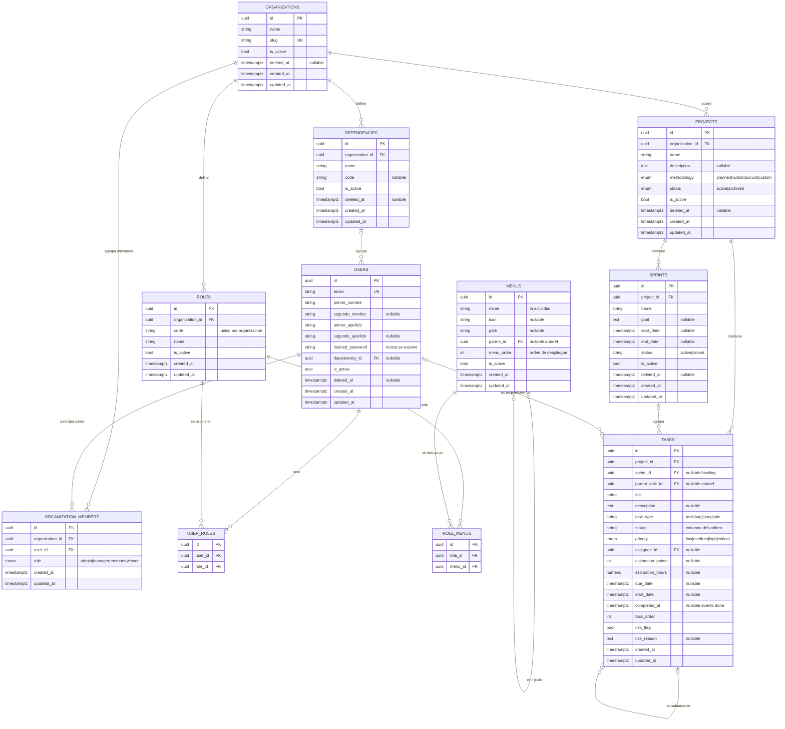

# Modelo de datos — Solercia Command

Este documento es el **mapa de referencia del esquema** de la base de datos. Reúne en un
solo lugar todas las tablas del MVP —las del clúster de **administración y gestión de
usuarios** (incorporadas en esta fase) y las del clúster de **proyectos y trabajo** (fases
anteriores)— con sus llaves primarias, columnas importantes y relaciones.

> Convención de idioma: los nombres de tablas, columnas y tipos se escriben en **inglés**
> (igual que el código). Las descripciones para la persona lectora van en **español
> colombiano formal**. El detalle de cada decisión vive en `docs/adr/`.

El esquema se construye con `Base.metadata.create_all` sobre una base recreada limpia
(`docker compose down -v`); en esta fase **no** hay migraciones Alembic (ver
`docs/adr/0003-mvp-schema-bootstrap.md` y `docs/adr/0008-rbac-and-jwt-refresh.md`).

---

## 1. Diagrama entidad-relación

El diagrama agrupa dos clústeres. Arriba, el clúster de **administración** que habilita la
gestión de usuarios y el control de acceso por roles (RBAC): `dependencies`, `roles`,
`menus` y los dos pivotes `user_roles` y `role_menus`, más la pertenencia al tenant
(`organization_members`). Abajo, el clúster de **proyectos**: `projects`, `sprints` y
`tasks`. La tabla `users` es la bisagra entre ambos.



> Notas sobre el diagrama:
> - `users.full_name` **no es una columna**: es una `hybrid_property` calculada como
>   `primer_nombre + ' ' + primer_apellido` (omitiendo los espacios sobrantes). Por eso no
>   aparece en el bloque de `USERS`. Ver la sección 4 y `docs/adr/0008-rbac-and-jwt-refresh.md`.
> - `menus.menu_order` y `tasks.task_order` corresponden al concepto lógico «order». Se les
>   da un nombre físico con prefijo para **esquivar la palabra reservada `ORDER`** de SQL,
>   igual que ya ocurre con `tasks` (mapeada a `task_order` en el modelo existente).
> - `menus` es una tabla **global** (a nivel de aplicación): no lleva `organization_id`. Las
>   actividades del menú son las mismas para todas las organizaciones; lo que cambia por
>   organización es **qué roles** las conceden (vía `role_menus`).
> - La cardinalidad `|o--o{` indica una FK **opcional** (`nullable`): el lado «uno» puede ser
>   cero. Aplica a `users.dependency_id`, `tasks.sprint_id`, `tasks.assignee_id` y las dos
>   autorreferencias (`tasks.parent_task_id`, `menus.parent_id`).

---

## 2. Leyenda de tablas

### Clúster de administración y gestión de usuarios

| Tabla                  | Propósito                                                                                          |
| ---------------------- | ------------------------------------------------------------------------------------------------- |
| `organizations`        | El **tenant**. Posee proyectos, dependencias, roles y miembros. Aislamiento por fila vía `organization_id`. |
| `users`                | Persona autenticable. Nombre desglosado (primer/segundo nombre y apellido), correo único, contraseña *hasheada* y una dependencia opcional. |
| `organization_members` | Pertenencia de un usuario a una organización con un **rol de tenant** (`admin\|manager\|member\|viewer`). Deriva el `organization_id` del usuario autenticado y gobierna `require_role` en los endpoints existentes. |
| `dependencies`         | «Dependencia» o área organizacional (p. ej. *Dirección*, *Tecnología*, *Operaciones*). Org-scoped. Un usuario pertenece a lo sumo a una. |
| `roles`                | **Rol de RBAC** definido por organización (`code` único por org). Agrupa permisos de navegación a través de `role_menus`. Distinto del rol de tenant en `organization_members`. |
| `menus`                | **Actividad** o ítem de navegación de la aplicación (nombre, ícono, ruta). Jerárquico vía `parent_id`. Global (sin `organization_id`). |
| `user_roles`           | Pivote **usuario ↔ rol**. `unique(user_id, role_id)` evita duplicados. Un usuario puede tener varios roles. |
| `role_menus`           | Pivote **rol ↔ menú**. `unique(role_id, menu_id)`. Define qué actividades concede cada rol; alimenta `GET /auth/me/menus`. |

### Clúster de proyectos y trabajo

| Tabla       | Propósito                                                                                              |
| ----------- | ----------------------------------------------------------------------------------------------------- |
| `projects`  | Proyecto del tenant, configurado por una `methodology` (patrón Strategy) que deriva columnas, estados, sprints y modo de estimación. |
| `sprints`   | Iteración con caja de tiempo dentro de un proyecto (Scrum). Estado `active\|closed`.                   |
| `tasks`     | Unidad de trabajo del tablero. Su `status` es el **rótulo de una columna** (no un enum global). Puede pertenecer a un sprint (`null` = backlog), tener una persona asignada y una tarea padre. `completed_at` marca el paso a la columna «done». |

---

## 3. Relaciones clave

| Relación                                  | Cardinalidad | Notas                                                                 |
| ----------------------------------------- | ------------ | --------------------------------------------------------------------- |
| `organizations` → `organization_members`  | 1 : N        | Una organización agrupa muchas membresías.                            |
| `users` → `organization_members`           | 1 : N        | El `organization_id` del usuario se deriva de su membresía.           |
| `organizations` → `dependencies`           | 1 : N        | Las dependencias son org-scoped.                                      |
| `organizations` → `roles`                  | 1 : N        | Los roles de RBAC son org-scoped (`code` único por org).             |
| `dependencies` → `users`                   | 1 : 0..N     | `users.dependency_id` es opcional (un usuario puede no tener área).   |
| `users` ↔ `roles` (vía `user_roles`)       | N : M        | `unique(user_id, role_id)`. Un usuario tiene uno o varios roles.      |
| `roles` ↔ `menus` (vía `role_menus`)       | N : M        | `unique(role_id, menu_id)`. Un rol concede un conjunto de menús.      |
| `menus` → `menus`                          | 1 : 0..N     | Autorreferencia `parent_id`: árbol jerárquico de actividades.        |
| `organizations` → `projects`               | 1 : N        | Multi-tenancy por fila.                                               |
| `projects` → `sprints`                     | 1 : N        | Sprints solo en metodologías con `sprints_enabled` (Scrum).          |
| `projects` → `tasks`                       | 1 : N        | Toda tarea pertenece a un proyecto.                                  |
| `sprints` → `tasks`                        | 1 : 0..N     | `tasks.sprint_id` opcional: `null` significa backlog.                |
| `users` → `tasks`                          | 1 : 0..N     | `tasks.assignee_id` opcional: una sola persona responsable por tarea. |
| `tasks` → `tasks`                          | 1 : 0..N     | Autorreferencia `parent_task_id`: subtareas.                         |

---

## 4. Nombre completo derivado (`users.full_name`)

`users` reemplaza la columna `full_name` por cuatro columnas de nombre desglosado. Para no
romper nada que ya consume `user.full_name` (el esquema `UserRead`, el `assignee_name` de
las tareas, la vista ejecutiva y el rendimiento), `full_name` pasa a ser una propiedad
**calculada** en el modelo, no un dato almacenado:

```python
# app/modules/users/models.py (esquema objetivo)
from sqlalchemy.ext.hybrid import hybrid_property

class User(...):
    primer_nombre: Mapped[str]
    segundo_nombre: Mapped[str | None]
    primer_apellido: Mapped[str]
    segundo_apellido: Mapped[str | None]
    dependency_id: Mapped[uuid.UUID | None]  # FK -> dependencies

    @hybrid_property
    def full_name(self) -> str:
        # primer_nombre + ' ' + primer_apellido, omitiendo espacios sobrantes.
        return " ".join(p for p in (self.primer_nombre, self.primer_apellido) if p)
```

Así, todo el código que lee `user.full_name` sigue funcionando sin cambios, y la API
mantiene el mismo contrato de salida. El detalle y las alternativas evaluadas están en
`docs/adr/0008-rbac-and-jwt-refresh.md`.

---

## 5. Referencias

- `docs/ARCHITECTURE.md` — visión transversal de la arquitectura y multi-tenancy por fila.
- `docs/AUTH.md` — autenticación (access + refresh) y autorización (RBAC y menús).
- `docs/API.md` — contrato de endpoints, incluidos `/admin/*`.
- `docs/adr/0001-multitenancy-row-level.md` — aislamiento por fila vía `organization_id`.
- `docs/adr/0005-work-items-status-as-column.md` — el `status` de la tarea es su columna.
- `docs/adr/0008-rbac-and-jwt-refresh.md` — split de nombre, RBAC y refresh por cookie.
