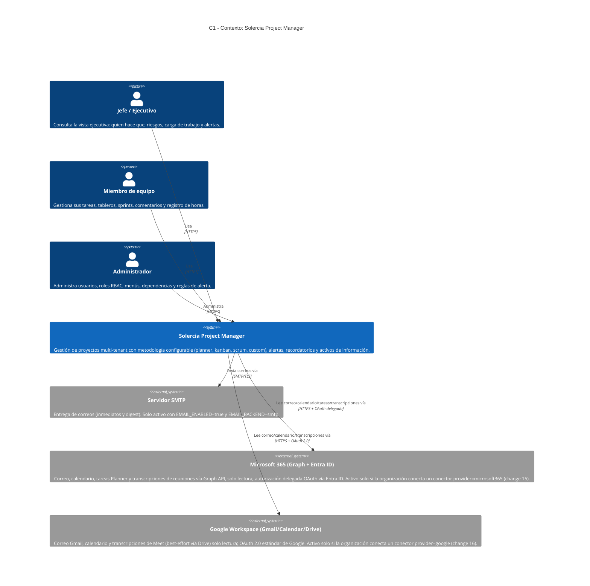
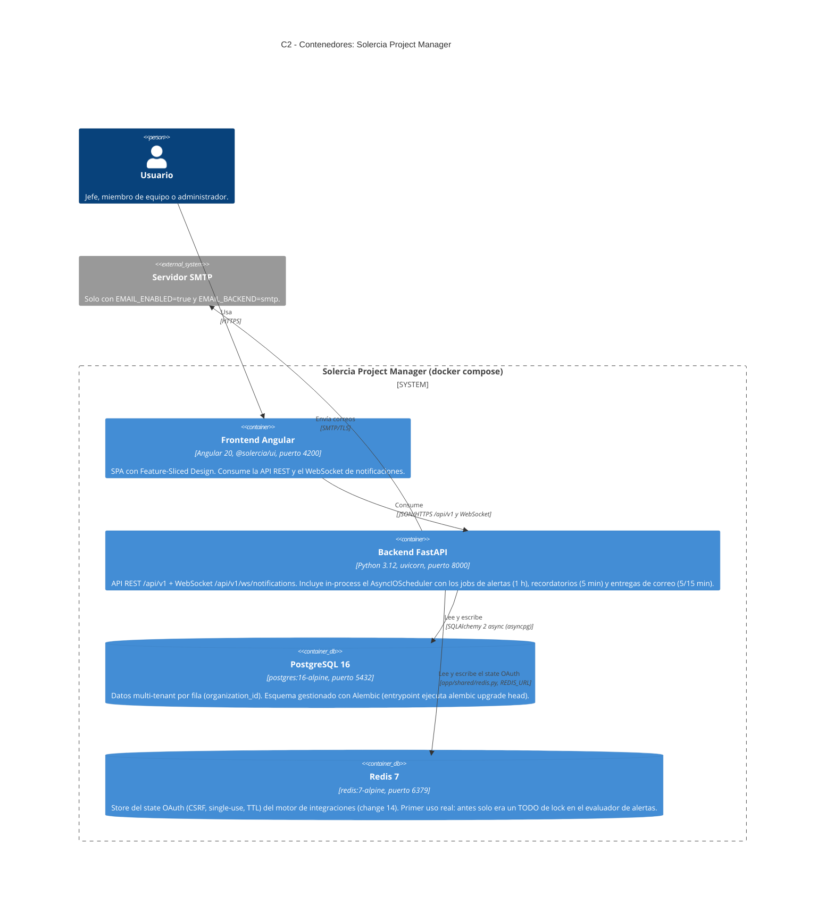

# Arquitectura C4 — Solercia Project Manager

**Propósito**: este es el **documento vivo** de la arquitectura del sistema en tres niveles
del modelo C4 (contexto, contenedores, componentes). Refleja el código **actual** —verificado
contra `docker-compose.yml`, `backend/app/main.py` y la estructura de `backend/app/`—, no la
arquitectura aspiracional.

**Fecha de línea base**: 2026-07-19 (rama `feat/consume-solercia-ui`).

> **Regla de actualización**: todo cambio que agregue o retire contenedores, módulos del
> backend, engines, integraciones externas o canales de entrega debe actualizar este
> documento **en el mismo commit** que introduce el cambio.

---

## C1 — Contexto del sistema

Tres perfiles de personas usan el sistema. El **servidor SMTP** participa solo cuando
`EMAIL_ENABLED=true` con `EMAIL_BACKEND=smtp` (por defecto el backend de correo es
`console`, que solo registra en log). **Microsoft 365 (Graph + Entra ID)** es la primera
integración externa real sobre el motor de conectores del cambio 14 (change
15-adapter-microsoft365): solo participa cuando una organización conecta un conector
`provider=microsoft365`, y únicamente en modo lectura (correo, calendario, tareas Planner,
transcripciones de reuniones). **Google Workspace (Gmail/Calendar/Drive)** es la segunda
integración real, sibling del 15 (change 16-adapter-google): solo participa cuando una
organización conecta un conector `provider=google`, también únicamente en modo lectura
(correo Gmail, calendario, transcripciones de Meet best-effort vía Drive).

---

## C2 — Contenedores

Verificado contra `docker-compose.yml` (4 servicios) y `backend/app/main.py`. Punto clave:
**el scheduler no es un contenedor aparte** — es un `AsyncIOScheduler` (APScheduler) que
arranca dentro del proceso uvicorn del backend durante el `lifespan`, y sobre esa misma
instancia se registran los jobs de alertas, recordatorios y entregas de correo.

Notas de contenedores:

- Los adjuntos se guardan en **disco local** del contenedor backend (`UPLOAD_DIR`,
  `./uploads`), no en un almacenamiento externo.
- El WebSocket es un canal *best-effort* controlado por `WS_ENABLED` (default `true`); REST
  sigue siendo autoritativo con o sin él.
- `EMAIL_ENABLED` es `false` por defecto: sin ese flag no se registran los jobs de entrega
  y no se contacta ningún SMTP.

---

## C3 — Componentes del backend

Por la cantidad de componentes, este nivel usa `flowchart` con subgrafos (más legible que
`C4Component` con ~30 nodos). Regla transversal: **router → service → repository**; el
service nunca toca SQLAlchemy directamente y las queries viven en el repository. No hay
middleware propio de auth/tenant: la autenticación y el scoping de tenant se resuelven con
**dependencias de FastAPI** (`app/dependencies.py`), no con la carpeta `middleware/` que
describe `CLAUDE.md` (no existe en el código).

```mermaid
flowchart TB
    subgraph http["Capa HTTP (routers /api/v1)"]
        direction LR
        r_negocio["Modulos de negocio:<br/>auth, projects, boards, tasks,<br/>comments, attachments, sprints,<br/>labels, checklists, task_links,<br/>time_logs, activity, dashboard, search"]
        r_admin["Modulos admin (rol ADMIN):<br/>dependencies, roles, menus, users,<br/>alerts (admin), alert_rules"]
        r_notif["Notificaciones y activos:<br/>notifications (+preferences),<br/>reminders, assets"]
        r_conn["connectors<br/>CRUD + authorize/callback OAuth<br/>+ cuentas conectadas<br/>(RBAC require_role admin|manager)"]
        r_ws["realtime.router<br/>WS /ws/notifications<br/>(si WS_ENABLED)"]
    end

    subgraph deps["app/dependencies.py (auth + tenant via Depends, sin middleware)"]
        d_auth["get_current_user /<br/>authenticate_access_token (JWT)"]
        d_tenant["get_current_membership<br/>(resuelve organization_id)"]
        d_rbac["require_role (rol de tenant)<br/>require_admin (RBAC ADMIN)<br/>get_actor_id (auditoría)"]
    end

    subgraph capas["Patrón por módulo (app/modules/*)"]
        service["service.py<br/>(reglas de negocio, valida<br/>status contra la Strategy)"]
        repo["repository.py<br/>(unico que toca SQLAlchemy)"]
        models["models.py + schemas.py<br/>(ORM + Pydantic v2)"]
    end

    subgraph metodo["app/methodology (Strategy)"]
        factory["factory.py"]
        strategies["planner / kanban /<br/>scrum / custom"]
        board_aware["board_aware.py<br/>(columnas reales del tablero<br/>como allowed_statuses)"]
    end

    subgraph engines["Engines top-level (in-process)"]
        subgraph alerts_e["app/alerts"]
            a_sched["scheduler (APScheduler, 1 h)"]
            a_eval["evaluator + registry"]
            a_strat["7 estrategias: task_overdue,<br/>task_at_risk, sprint_at_risk,<br/>workload_imbalance, blocked_task,<br/>license_expiring, license_expired"]
        end
        subgraph rem_e["app/reminders"]
            rm_sched["job cada 5 min<br/>(mismo scheduler)"]
            rm_disp["dispatcher + registry<br/>estrategia task_due_soon"]
        end
        subgraph notify_e["app/notify"]
            n_disp["dispatcher de canales<br/>(delivery_dispatch)"]
            n_model["NotificationDelivery<br/>(outbox agnostico de canal)"]
        end
        subgraph email_e["app/email"]
            e_sender["sender (smtp o console)"]
            e_digest["digest + templates + policy"]
            e_sched["jobs entrega 5 min / digest 15 min<br/>(si EMAIL_ENABLED)"]
        end
        subgraph rt_e["app/realtime"]
            rt_mgr["manager (conexiones WS)"]
            rt_pub["publisher (push best-effort)"]
        end
        subgraph integrations_e["app/integrations (change 14)"]
            i_ports["ports.py: 5 protocolos read-only<br/>+ IntegrationAdapter + AccessContext"]
            i_registry["registry.py: adaptadores por<br/>provider (import-time, sin tocar el nucleo)"]
            i_oauth["oauth.py: build_authorize /<br/>handle_callback generico"]
            i_crypto["crypto.py: Fernet<br/>(tokens cifrados en reposo)"]
            i_state["state_store.py: state OAuth<br/>en Redis (SETEX + GETDEL single-use)"]
            i_fake["adapters/fake.py: adaptador en<br/>memoria"]
            i_ms365["adapters/microsoft365/ (change 15):<br/>GraphClient httpx inyectable + OAuth<br/>Entra ID delegado + correo/calendario/<br/>Planner/notas de reunión, solo lectura"]
            i_google["adapters/google/ (change 16):<br/>GoogleClient httpx inyectable + OAuth<br/>2.0 estandar + Gmail/Calendar/Drive<br/>(correo/calendario/notas Meet<br/>best-effort), solo lectura"]
        end
    end

    subgraph shared["app/shared"]
        sh["base_model (mixins), enums,<br/>exceptions, pagination, security (JWT),<br/>redis (get_redis_client)"]
    end

    db[("PostgreSQL")]
    redis_ext[("Redis")]
    smtp_ext[["Servidor SMTP"]]
    graph_ext[["Microsoft 365<br/>(Graph + Entra ID)"]]
    google_ext[["Google Workspace<br/>(Gmail/Calendar/Drive)"]]

    http --> deps
    deps --> capas
    service --> repo
    repo --> models
    repo --> db
    service --> metodo
    a_eval --> a_strat
    a_sched --> a_eval
    a_eval -->|"crea Notification via service"| capas
    rm_disp -->|"crea Notification"| capas
    capas -->|"al crear Notification"| n_disp
    n_disp --> n_model
    n_disp --> e_sender
    e_sched --> n_disp
    e_sender --> smtp_ext
    capas -->|"publica eventos"| rt_pub
    rt_pub --> rt_mgr
    rt_mgr --> r_ws
    capas --> shared
    engines --> db
    r_conn --> capas
    r_conn -->|"authorize/callback"| i_oauth
    i_oauth --> i_state
    i_oauth --> i_registry
    i_registry --> i_fake
    i_registry --> i_ms365
    i_registry --> i_google
    i_ms365 -->|"solo lectura: GET correo/calendario/<br/>Planner/transcripciones"| graph_ext
    i_ms365 -->|"OAuth Entra ID (authorize/token/refresh)"| graph_ext
    i_google -->|"solo lectura: GET Gmail/Calendar/<br/>Drive (export transcripciones)"| google_ext
    i_google -->|"OAuth 2.0 (authorize/token/refresh/userinfo)"| google_ext
    r_conn -->|"cifra/descifra tokens"| i_crypto
    i_state --> redis_ext
```

Notas de componentes:

- **Metodología (Strategy)**: la API lee el comportamiento (columnas por defecto, estados
  permitidos, sprints, modo de estimación) desde la strategy del proyecto; `board_aware`
  hace que, con tablero configurado, los `status_key` de las columnas reales sean la fuente
  de `allowed_statuses` — nunca hay `if methodology == ...` regado por el código.
- **Scheduler único**: `app/alerts/scheduler.py` crea el `AsyncIOScheduler`; los jobs de
  recordatorios y de entregas se registran sobre **esa misma instancia** en el `lifespan`.
  Cada registro tiene su `try/except` aislado: un fallo no tumba el arranque de la API.
- **Outbox de entregas**: `notification_deliveries` desacopla la creación de la notificación
  del envío por canal; `dedup_key` único evita el doble encolado y `delivery_dispatch` es el
  único despachador.
- **Módulos sin modelos**: `auth`, `dashboard` y `search` solo exponen router/service sobre
  tablas de otros módulos.
- **Seed**: `app/db_init.py` puebla datos por defecto al arrancar (después de que el
  entrypoint ejecute `alembic upgrade head`).
- **Integraciones (change 14-integration-ports)**: `app/integrations/` es un motor
  hermano de `notify`/`alerts`/`email`/`realtime` — puertos de lectura por capacidad
  (correo, calendario, tareas externas, notas, tickets), registro de adaptadores por
  `provider` en import-time (sin `if provider == ...` regado por el código) y handshake
  OAuth genérico (`authorize`/`callback`) que delega el canje de tokens al adaptador. El
  módulo `app/modules/connectors` (router→service→repository, mismo patrón que `assets`)
  expone el CRUD y el flujo OAuth vía REST, con RBAC `require_role(admin, manager)` para
  configurar conectores. Es el **primer consumidor real** de `require_role`
  (`app/dependencies.py`, ya existía sin uso) y del cliente Redis (`app/shared/redis.py`,
  nuevo — el state OAuth es el primer dato que realmente pasa por Redis).
- **Adaptador Microsoft 365 (change 15-adapter-microsoft365)**: primer adaptador REAL
  sobre el núcleo del 14, `app/integrations/adapters/microsoft365/` (7 módulos:
  `__init__`/`adapter`/`oauth`/`client`/`mappers`/`ports`/`errors`), auto-registrado en
  import-time (mismo precedente que `adapters/fake.py`, cero ediciones a `ports.py`/
  `oauth.py`/`registry.py` del 14). `GraphClient` (httpx inyectable, cero red en tests)
  centraliza paginación `@odata.nextLink`, TLS obligatorio + anti-SSRF (host fijo desde
  `M365_GRAPH_BASE_URL`), refresco 401→reintento único y backoff 429 con `Retry-After`.
  Implementa `MailReaderPort`, `CalendarReaderPort`, `ExternalTaskReaderPort` (solo
  Planner, sin Microsoft To Do) y `MeetingNotesReaderPort` (degrada a
  `capability_unavailable` sin red cuando el conector no tiene el scope
  `OnlineMeetingTranscript.Read.All`, o ante un `403` en runtime); **nunca** declara la
  capacidad `tickets`. Frontera solo-lectura estricta: ninguna llamada del paquete usa
  `POST`/`PATCH`/`PUT`/`DELETE` hacia Graph — la única escritura HTTP es el `POST` de
  `oauth.py` contra el endpoint de token de Entra ID (login.microsoftonline.com), que no
  es una escritura hacia Graph.
- **Adaptador Google (change 16-adapter-google)**: segundo adaptador REAL sobre el
  núcleo del 14, sibling del 15, `app/integrations/adapters/google/` (8 módulos:
  `__init__`/`adapter`/`oauth`/`client`/`mail`/`calendar`/`meeting_notes`/`mime`/`errors`
  — un archivo por capacidad, en vez del `ports.py` consolidado del 15), también
  auto-registrado en import-time (cero ediciones a `ports.py`/`oauth.py`/`registry.py`
  del 14). `GoogleClient` (httpx inyectable, cero red en tests) centraliza el mapeo de
  errores (`errors.error_for_response`, taxonomía espejo del 15 más
  `provider_request_failed` para distinguir 4xx no reintentables de 5xx), refresco
  401→reintento único y backoff 429/403 `rateLimitExceeded`/`userRateLimitExceeded` con
  techo `GOOGLE_MAX_BACKOFF_SECONDS`. A diferencia del `@odata.nextLink` de Graph (una URL
  completa a seguir, validada por host), la paginación de Google usa `nextPageToken` — un
  token opaco enviado como query param sobre el `base_url` fijo de cada API — así que el
  límite anti-SSRF es estructural (ninguna solicitud se construye a partir de datos de la
  respuesta) en vez de una validación de host en runtime. Implementa `MailReaderPort`
  (Gmail, con parseo MIME multiparte base64url propio en `mime.py`; `labelIds`/`threadId`
  quedan como metadato interno, nunca expuestos como carpeta) y `CalendarReaderPort`
  (Calendar, ventana `since`→`timeMin`/`timeMax`=ahora); `MeetingNotesReaderPort` busca la
  carpeta "Meet Recordings" en Drive y exporta a texto plano el Doc de transcripción que
  encuentre — sin carpeta/Doc (organizador sin transcripción activada) degrada a lista
  vacía sin error, mientras que un `403` real de Drive (sin permiso sobre el Drive del
  organizador) se propaga como `capability_unavailable` sin afectar correo/calendario del
  mismo adaptador. `external_account_id` es el correo resuelto vía `userinfo` (no un `sub`
  opaco, divergencia deliberada frente al `oid` del 15); ante un refresh SIN
  `refresh_token` en la respuesta (frecuente en Google), conserva el `refresh_token`
  anterior en vez de perder la credencial. **Nunca** declara la capacidad `external_tasks`
  (Google Tasks queda fuera de este cambio) ni `tickets`. Frontera solo-lectura estricta:
  la única escritura HTTP del paquete es el `POST` de `oauth.py` contra el endpoint de
  token de Google (oauth2.googleapis.com), nunca hacia Gmail/Calendar/Drive.

## Referencias

- `backend/app/main.py` — registro de routers, lifespan y schedulers.
- `backend/app/config.py` — flags (`WS_ENABLED`, `EMAIL_ENABLED`, intervalos de jobs).
- `docs/diagrams/er-model.md` — modelo entidad-relación vivo.
- `docs/ARCHITECTURE.md` — narrativa extendida de la arquitectura.
