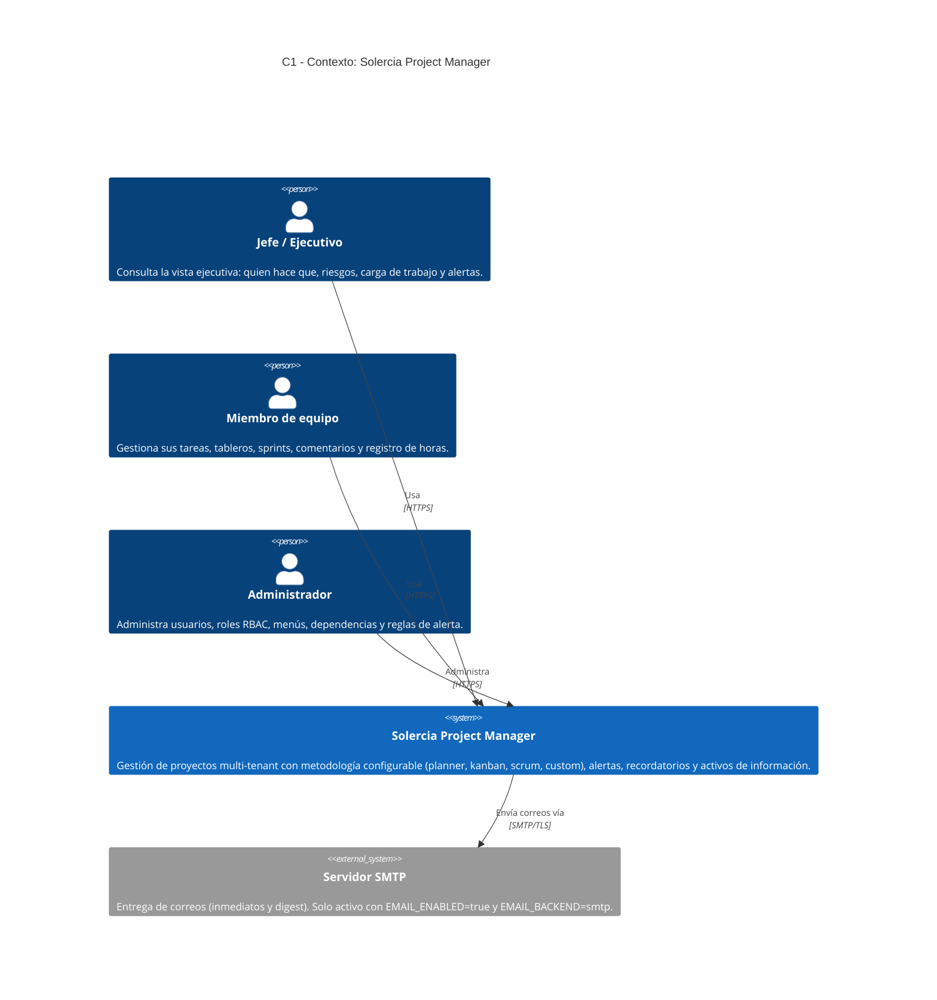
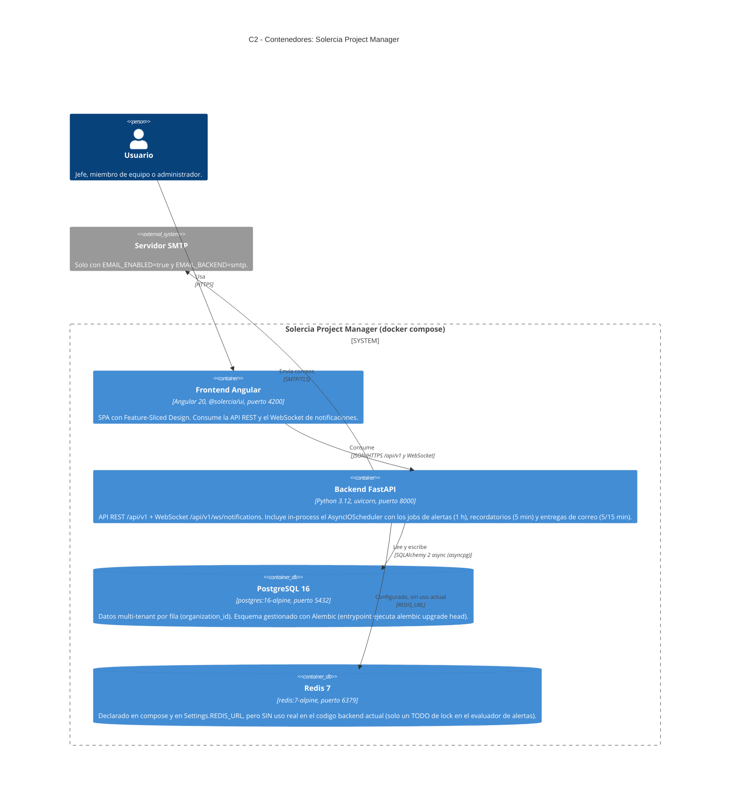
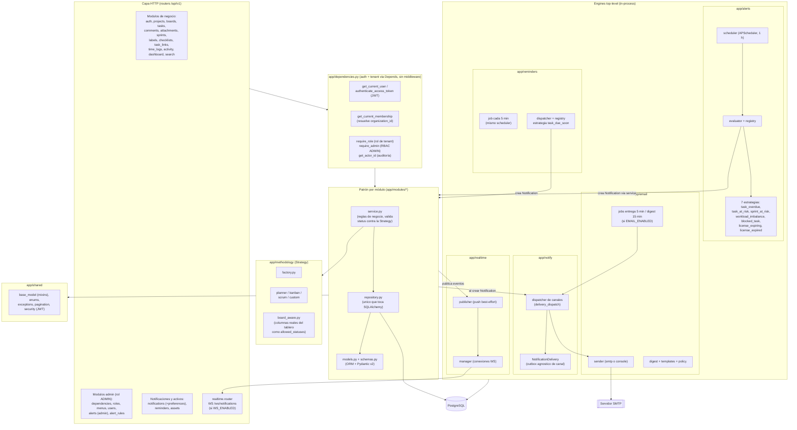

# Arquitectura C4 — Solercia Project Manager

**Propósito**: este es el **documento vivo** de la arquitectura del sistema en tres niveles
del modelo C4 (contexto, contenedores, componentes). Refleja el código **actual** —verificado
contra `docker-compose.yml`, `backend/app/main.py` y la estructura de `backend/app/`—, no la
arquitectura aspiracional.

**Fecha de línea base**: 2026-07-18 (rama `feat/consume-solercia-ui`).

> **Regla de actualización**: todo cambio que agregue o retire contenedores, módulos del
> backend, engines, integraciones externas o canales de entrega debe actualizar este
> documento **en el mismo commit** que introduce el cambio.

---

## C1 — Contexto del sistema

Tres perfiles de personas usan el sistema. El único sistema externo del código actual es el
**servidor SMTP**, y solo participa cuando `EMAIL_ENABLED=true` con `EMAIL_BACKEND=smtp`
(por defecto el backend de correo es `console`, que solo registra en log). No existen otras
integraciones externas en el código hoy.

---

## C2 — Contenedores

Verificado contra `docker-compose.yml` (4 servicios) y `backend/app/main.py`. Punto clave:
**el scheduler no es un contenedor aparte** — es un `AsyncIOScheduler` (APScheduler) que
arranca dentro del proceso uvicorn del backend durante el `lifespan`, y sobre esa misma
instancia se registran los jobs de alertas, recordatorios y entregas de correo.

Notas de contenedores:

- Los adjuntos se guardan en **disco local** del contenedor backend (`UPLOAD_DIR`,
  `./uploads`), no en un almacenamiento externo.
- El WebSocket es un canal *best-effort* controlado por `WS_ENABLED` (default `true`); REST
  sigue siendo autoritativo con o sin él.
- `EMAIL_ENABLED` es `false` por defecto: sin ese flag no se registran los jobs de entrega
  y no se contacta ningún SMTP.

---

## C3 — Componentes del backend

Por la cantidad de componentes, este nivel usa `flowchart` con subgrafos (más legible que
`C4Component` con ~30 nodos). Regla transversal: **router → service → repository**; el
service nunca toca SQLAlchemy directamente y las queries viven en el repository. No hay
middleware propio de auth/tenant: la autenticación y el scoping de tenant se resuelven con
**dependencias de FastAPI** (`app/dependencies.py`), no con la carpeta `middleware/` que
describe `CLAUDE.md` (no existe en el código).

Notas de componentes:

- **Metodología (Strategy)**: la API lee el comportamiento (columnas por defecto, estados
  permitidos, sprints, modo de estimación) desde la strategy del proyecto; `board_aware`
  hace que, con tablero configurado, los `status_key` de las columnas reales sean la fuente
  de `allowed_statuses` — nunca hay `if methodology == ...` regado por el código.
- **Scheduler único**: `app/alerts/scheduler.py` crea el `AsyncIOScheduler`; los jobs de
  recordatorios y de entregas se registran sobre **esa misma instancia** en el `lifespan`.
  Cada registro tiene su `try/except` aislado: un fallo no tumba el arranque de la API.
- **Outbox de entregas**: `notification_deliveries` desacopla la creación de la notificación
  del envío por canal; `dedup_key` único evita el doble encolado y `delivery_dispatch` es el
  único despachador.
- **Módulos sin modelos**: `auth`, `dashboard` y `search` solo exponen router/service sobre
  tablas de otros módulos.
- **Seed**: `app/db_init.py` puebla datos por defecto al arrancar (después de que el
  entrypoint ejecute `alembic upgrade head`).

## Referencias

- `backend/app/main.py` — registro de routers, lifespan y schedulers.
- `backend/app/config.py` — flags (`WS_ENABLED`, `EMAIL_ENABLED`, intervalos de jobs).
- `docs/diagrams/er-model.md` — modelo entidad-relación vivo.
- `docs/ARCHITECTURE.md` — narrativa extendida de la arquitectura.
