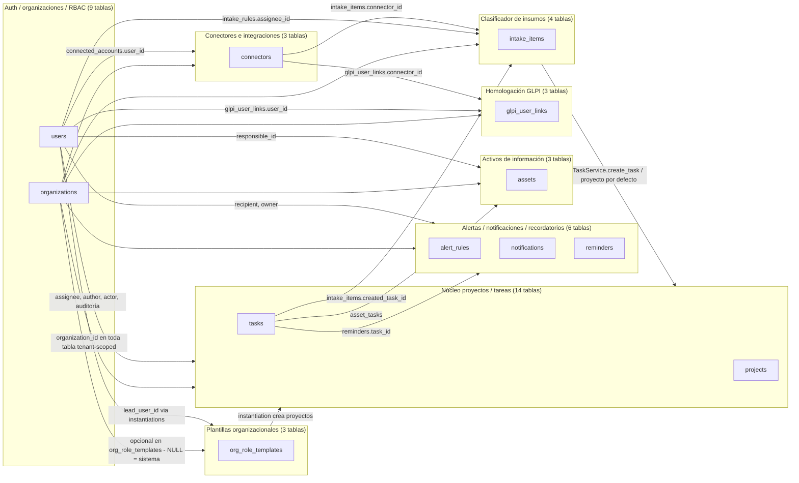
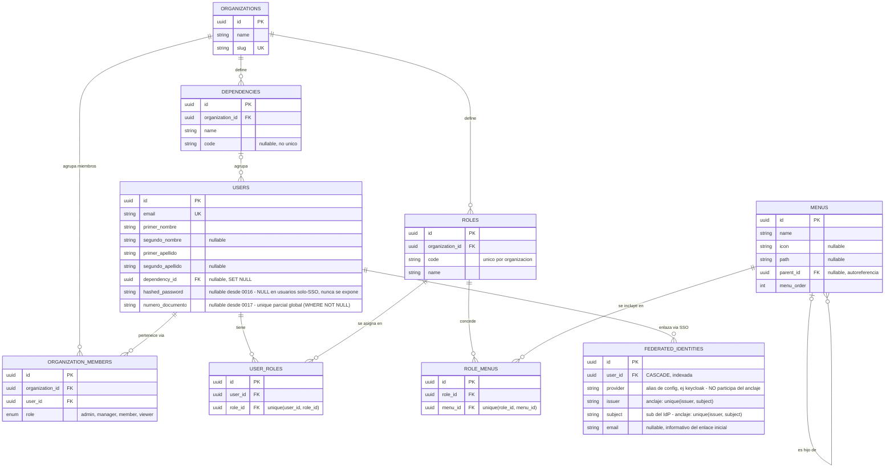
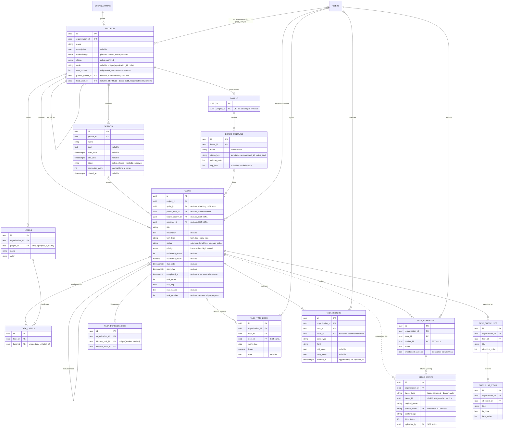
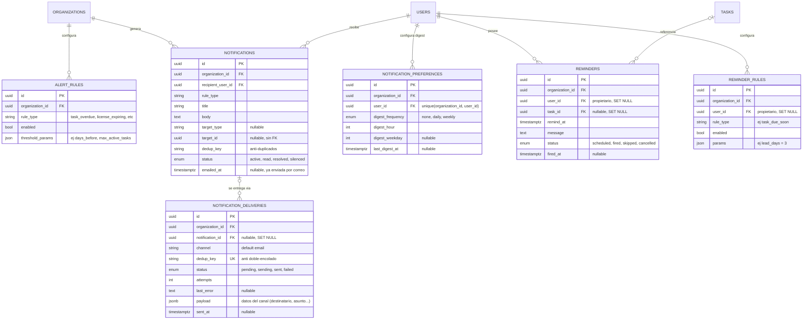
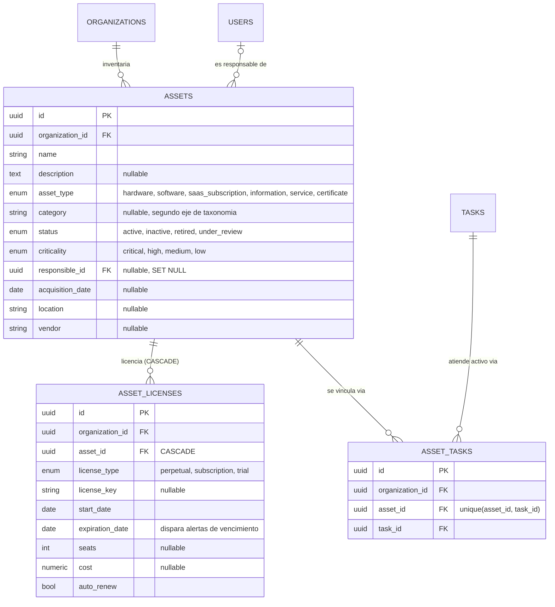
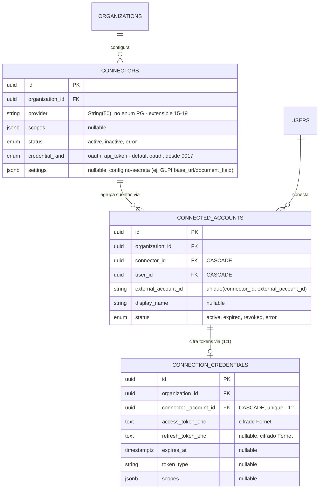
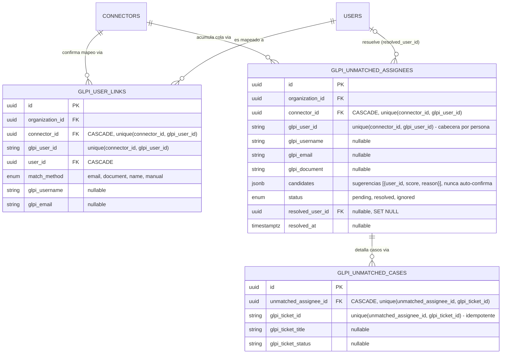
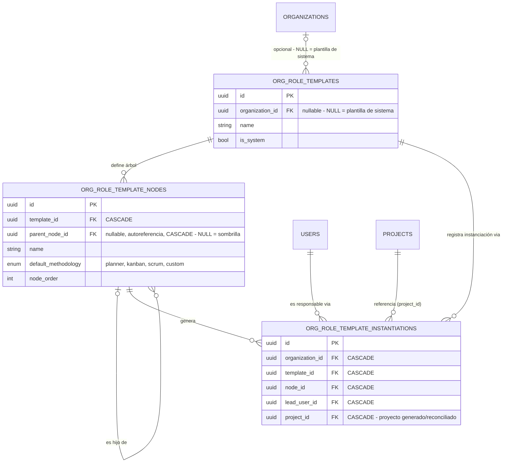
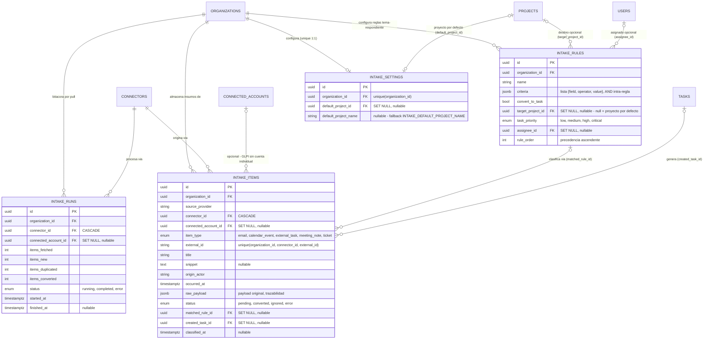

# Modelo entidad-relación — Solercia Project Manager

**Propósito**: este es el **documento vivo** del esquema de base de datos. Refleja, tabla por
tabla, los modelos SQLAlchemy reales de `backend/app/modules/*/models.py`,
`backend/app/notify/models.py` y los mixins de `backend/app/shared/base_model.py`. La fuente
de verdad es el **código**; este documento es su espejo navegable.

**Fecha de línea base**: 2026-07-19 (estado del código en la rama `feat/consume-solercia-ui`,
migraciones Alembic hasta `0019_add_intake`).

> **Regla de actualización**: todo cambio de base de datos (modelo nuevo, columna nueva,
> enum nuevo, FK nueva o eliminada) debe actualizar este documento **en el mismo commit de la
> migración Alembic** que lo introduce. Un diagrama desactualizado es peor que ninguno.

> Nota: la imagen `docs/diagrams/erd.png` es una captura histórica anterior a esta línea base.
> Se conserva como referencia, pero **este archivo es la fuente viva** del diagrama.

**Total de tablas**: 41.

---

## Convenciones y mixins

Los modelos componen mixins de `app/shared/base_model.py`. Para no repetir columnas triviales
en cada bloque del diagrama, se omiten y se documentan aquí una sola vez:

| Mixin | Columnas que aporta | Notas |
|-------|---------------------|-------|
| `PkMixin` | `id uuid PK` | UUID generado en la aplicación. Todas las tablas lo usan. |
| `TimestampMixin` | `created_at`, `updated_at` (timestamptz) | Todas las tablas **excepto** `task_history` (append-only, define su propio `created_at`). |
| `SoftDeleteMixin` | `is_active bool`, `deleted_at timestamptz?` | Borrado lógico. No lo llevan las tablas pivote de borrado físico (`user_roles`, `role_menus`, `task_labels`, `asset_tasks`, `organization_members`) ni `notifications`, `notification_preferences`, `notification_deliveries`, `task_history`. |
| `TenantMixin` | `organization_id uuid FK → organizations` | Aislamiento multi-tenant por fila (`ondelete=CASCADE`). |
| `AuditMixin` | `created_by uuid? FK → users`, `updated_by uuid? FK → users` | `ondelete=SET NULL`; lo estampa el service desde el actor autenticado. Estas dos FK hacia `users` **no se dibujan** como aristas para no saturar el diagrama. |

Otras convenciones del esquema:

- Los enums se persisten como `VARCHAR` con `CHECK` (`native_enum=False`); en los diagramas
  se anotan como `enum` con sus valores.
- La columna lógica `order` se mapea a nombres físicos no reservados: `tasks.task_order`,
  `board_columns.column_order`, `task_checklists.checklist_order`, `checklist_items.item_order`,
  `menus.menu_order`.
- `tasks.status` es texto libre validado contra la metodología del proyecto (columnas del
  tablero), **no** un enum global.
- Las relaciones punteadas (`..`) indican vínculos lógicos sin FK física (validados en el
  service), como los destinos polimórficos de `attachments`.

---

## Vista general por dominios

Relaciones entre dominios (cada caja se detalla en su propia sección):

---

## Dominio 1 — Auth, organizaciones y RBAC

`organizations` es el tenant. `organization_members` da el **rol de tenant**
(`admin|manager|member|viewer`) que gobierna `require_role`. Aparte, `roles` + `user_roles` +
`role_menus` + `menus` forman el RBAC de navegación (el rol `ADMIN` habilita los endpoints
`/admin/*`). `dependencies` son áreas organizacionales (concepto distinto de
`task_dependencies` del dominio 2).

Notas del dominio:

- `users.full_name` **no es columna**: es una `hybrid_property` (`primer_nombre` +
  `primer_apellido`).
- `menus` es **global** (sin `organization_id`); lo que varía por organización es qué roles
  conceden cada menú.
- `roles` lleva `unique(organization_id, code)`.
- `federated_identities` (change 20-sso-keycloak, migración `0016`) enlaza un `user` a una
  identidad OIDC externa. El anclaje criptográfico es `UNIQUE(issuer, subject)` — `sub` solo es
  único por `issuer` (correctitud OIDC); `provider` es solo el alias de configuración que enruta
  qué proveedor usar, nunca participa del anclaje. Tras el primer enlace el `email` queda
  desactualizado a propósito (informativo, no se usa para resolver el usuario de nuevo). Mixins
  Pk/Timestamp/SoftDelete/Audit — **sin** `TenantMixin`: el aislamiento por organización llega
  transitivamente vía `user_id -> organization_members`.
- `users.hashed_password` es **nullable** desde la migración `0016`: un usuario creado o
  enlazado únicamente por SSO (auto-provisión, `SSO_AUTO_PROVISION=true`) nunca recibe
  contraseña local. El login por credenciales rechaza `hashed_password IS NULL` con el mismo
  mensaje genérico de credenciales inválidas (nunca revela el método de login de la cuenta). La
  migración `0016.downgrade()` se niega a restaurar `NOT NULL` si existe algún usuario
  solo-SSO, para no corromper esas cuentas.
- `users.numero_documento` (change 17-adapter-glpi, migración `0017`) es el documento de
  identidad, nullable, con índice **único parcial** `WHERE numero_documento IS NOT NULL`
  (`uq_users_numero_documento`, declarado también a nivel ORM en `Index(...)` para que
  `Base.metadata.create_all` lo respete en tests, no solo la migración). Alcance **global**
  (igual que `email`), no por organización — `User` no tiene `TenantMixin` en el código real.
  Segundo nivel determinístico de la cascada de homologación GLPI (correo -> documento ->
  nombre), ver Dominio 6.

---

## Dominio 2 — Núcleo de proyectos y tareas

`projects` se configura con una `methodology` (patrón Strategy). Cada proyecto tiene a lo sumo
**un** tablero (`boards.project_id` es `unique`) cuyas `board_columns` definen el `status`
que adopta la tarea al entrar en la columna (`status_key`). `tasks.status` sigue siendo el
campo validado; `board_column_id` es la fuente en runtime cuando hay tablero configurado.

Notas del dominio:

- `projects.parent_project_id` (change 21-project-hierarchy, migración `0014`) modela una
  jerarquía padre-hijo entre proyectos de la MISMA organización, mismo patrón de
  autoreferencia que `tasks.parent_task_id` (`SET NULL`, indexada). Cada subproyecto conserva
  su propia `methodology` (Strategy intacto); la jerarquía es puramente estructural. Validación
  de ciclos/profundidad máxima (`PROJECT_HIERARCHY_MAX_DEPTH`, por defecto 5) vive en el
  service, no en la base de datos.
- `task_dependencies` modela la arista dirigida canónica «`blocker` bloquea a `blocked`»;
  la vista inversa `is_blocked_by` se calcula, nunca es una segunda fila. Desvincular hace
  `is_active=false`, **nunca** DELETE físico (el DFS anti-ciclos filtra por `is_active`).
- `attachments` es polimórfica (`target_type` + `target_id`), por eso las aristas punteadas.
- `task_history` es append-only: sin `TimestampMixin`, sin soft delete; la fila **es** el
  registro de auditoría.
- `tasks.task_number` + `projects.code` forman la llave visible `task_key` (p. ej. `SDM-7`),
  asignada atómicamente vía `UPDATE ... RETURNING` sobre `projects.task_counter`.
- `projects.lead_user_id` (change 23-org-role-templates, migración `0018`) es el
  responsable/cabeza del proyecto. Poblado SIEMPRE por la instanciación de una plantilla
  organizacional (Dominio 7); los proyectos creados por el flujo directo `POST /projects` lo
  mantienen `NULL` (compatibilidad, ver `specs/projects/spec.md` delta).

---

## Dominio 3 — Alertas, notificaciones y recordatorios

`alert_rules` configura el motor de alertas por organización; el evaluador genera
`notifications` (in-app) con `dedup_key` anti-duplicados. `notification_preferences` guarda
la cadencia de digest de correo por usuario. `notification_deliveries` es el **outbox**
agnóstico de canal (hoy solo canal `email`). `reminders`/`reminder_rules` son recursos
estrictamente personales (ni un admin ve los de otra persona).

Notas del dominio:

- `notifications`, `notification_preferences` y `notification_deliveries` **no** llevan
  `SoftDeleteMixin`; las preferencias se *upsertean* en sitio (una fila por org+usuario).
- El `CHECK` del enum de `notification_deliveries.status` conserva el nombre histórico
  `email_outbox_status` (renombre de `email_outbox` en la migración `0013`).

---

## Dominio 4 — Activos de información (SDMujer)

Inventario de activos con licencias (composición: la licencia no sobrevive al activo) y
vínculo M:N a tareas existentes.

Notas del dominio:

- `asset_criticality` es un enum propio, deliberadamente **no** reutiliza `Priority` de
  tareas aunque los valores coincidan.
- `asset_tasks` diverge del precedente `task_labels`: lleva `organization_id` directo para
  filtrar por tenant sin join extra. Sin soft delete: desvincular borra la fila.

---

## Dominio 5 — Conectores e integraciones

Configuración de conectores OAuth/api_token por organización (change 14-integration-ports,
delta `credential_kind`/`settings` en change 17-adapter-glpi): `connectors`
es la config del proveedor (p. ej. Microsoft 365, Google, GLPI, Jira — adaptadores reales en
los cambios 15-19). `connected_accounts`
es la cuenta que un usuario conectó bajo ese proveedor — la unicidad es por
`external_account_id` **dentro del conector**, nunca por `(user_id, provider)`: un usuario
puede conectar varias cuentas del mismo proveedor (ej. dos buzones de correo). Los tokens
viven **aislados** en `connection_credentials` (1:1 con la cuenta, cifrados con Fernet),
nunca junto a los campos que la API expone directamente sobre `connected_accounts`. El
`state` OAuth (CSRF, single-use) vive en Redis con TTL, no en una tabla.

Notas del dominio:

- `connection_credentials` **no** lleva `SoftDeleteMixin`: es un hijo estrictamente
  1:1 (`ondelete=CASCADE`) de `connected_accounts` — desconectar una cuenta hace soft-delete
  de `ConnectedAccount` (respeta auditoría vía `SoftDeleteMixin`) y **DELETE físico (purga)** de
  `ConnectionCredentials` (postura conservadora de seguridad: los tokens cifrados no permanecen
  en la base tras la desconexión, incluso como borrados lógicos). Reconectar la misma cuenta
  externa reactiva la fila soft-deleted de la cuenta y guarda credenciales nuevas.
- El `state` OAuth (CSRF, anti-replay) NO es una tabla: vive en Redis
  (`oauth:state:{state}`, `SETEX`+`GETDEL` single-use) — decisión ratificada, TTL nativo sin
  necesidad de limpieza.
- `AccessContext` (contrato de `app/integrations/ports.py`, no persistido) transporta el
  token descifrado + `scopes` + un sink opcional `on_tokens_refreshed` para que un adaptador
  que rota tokens en una lectura los devuelva sin conocer la persistencia — lo consumen los
  adaptadores de los cambios 15/16 y el cambio 22.
- `connectors.credential_kind` (change 17-adapter-glpi, migración `0017`) distingue `oauth`
  (`authorize`/`callback`, changes 15/16) de `api_token` (registro directo de credenciales,
  GLPI). Se fija al crear el conector y no cambia después sin recrearlo.
  `connectors.settings` (JSONB, nullable) es configuración no-secreta específica del
  proveedor (ej. `base_url`/`document_field` de GLPI) — el 17 es **dueño** de la columna;
  los cambios 18/19 solo la consumen con su propio namespace, nunca agregan columna nueva.
  Las credenciales `api_token` de GLPI reutilizan `connection_credentials` sin columna nueva:
  `access_token_enc`=user_token, `refresh_token_enc`=App-Token, `token_type="glpi"`,
  `expires_at=NULL` (la vida de la sesión GLPI la maneja Redis, no esta tabla).

---

## Dominio 6 — Homologación de usuarios GLPI

Change 17-adapter-glpi (user-homologation spec). Cada persona **asignada** de un caso GLPI se
homologa contra un `user` real de la plataforma mediante una cascada determinística
(correo -> `numero_documento` -> nombre). Los niveles 1 y 2 auto-confirman
(`glpi_user_links`); el nivel 3 (nombre) **nunca** auto-confirma — solo sugiere candidatos y
cae en la cola (`glpi_unmatched_assignees` + `glpi_unmatched_cases`). La sync dispara **por
caso**, pero la cola consolida **por persona GLPI**: un segundo caso sin homologar de la
misma persona se agrega al detalle de la cabecera existente, nunca duplica la persona.

Notas del dominio:

- `glpi_user_links` — Pk+Timestamp+SoftDelete+Audit+Tenant. Mapeo **confirmado**; toda sync
  futura de ese `glpi_user_id` resuelve directo contra este link, sin repetir la cascada.
  Revocarlo (soft-delete) devuelve a esa persona a la cascada en la siguiente sync.
- `glpi_unmatched_assignees` (cabecera) — Pk+Timestamp+Audit+Tenant, **sin** `SoftDeleteMixin`:
  `status` (`pending|resolved|ignored`) ES el ciclo de vida de la fila; resolver/ignorar la
  cambia en el sitio en vez de borrarla lógicamente.
  `UNIQUE(connector_id, glpi_user_id)` — **una fila por persona GLPI sin homologar**, no por
  caso.
- `glpi_unmatched_cases` (detalle) — Pk+Timestamp únicamente (sin Audit/Tenant: el aislamiento
  llega transitivamente vía la cabecera -> `connector_id` -> organización). 1:N off la
  cabecera; `UNIQUE(unmatched_assignee_id, glpi_ticket_id)` hace idempotente un segundo caso de
  la misma persona (se agrega al detalle, nunca duplica la cabecera).
- Resolver una cabecera crea el `glpi_user_link` (`match_method=manual`), la cabecera pasa a
  `resolved` y el detalle queda como histórico. Ignorarla la retira de la vista activa sin
  crear ningún link.
- Todas las consultas están scoped por `organization_id` (directo en las tres tablas, vía
  `TenantMixin`) — una cola/link de la organización A nunca es visible ni resoluble desde B.

---

## Dominio 7 — Plantillas organizacionales de alto cargo

Change 23-org-role-templates (migración `0018`). Perfiles predefinidos que, al instanciarse,
generan de una sola vez el árbol de proyectos (Dominio 2) de un área con un responsable
(`lead_user_id`). `org_role_templates` es la cabecera (`organization_id` nullable = plantilla de
**sistema**, sembrada por `db_init.seed_default`); `org_role_template_nodes` es el árbol
(sombrilla/rama/equipo) de la plantilla; `org_role_template_instantiations` es el **ledger** de
idempotencia — la instanciación reconcilia contra esta tabla, nunca contra el nombre del proyecto
generado.

Notas del dominio:

- `org_role_templates`/`org_role_template_nodes` — Pk+Timestamp (la cabecera además
  Pk+Timestamp+SoftDelete+Audit); las 5 plantillas de sistema son sembradas idempotentemente
  (patrón `_ensure_*` de `db_init.py`), NUNCA en la migración (`bulk_insert = 0` en el repo).
- `org_role_template_instantiations` — Pk+Timestamp únicamente, sin `TenantMixin` directo aunque
  lleva `organization_id` explícito: es el **ledger** de idempotencia,
  `UNIQUE(organization_id, template_id, node_id, lead_user_id)`. La instanciación REUSA la fila
  cuando el `project_id` referenciado sigue `is_active=true`; si el proyecto fue soft-deleted, la
  fila se ACTUALIZA (nunca se inserta un duplicado) con el `project_id` del proyecto recreado.
- La instanciación recorre `org_role_template_nodes` padre→hijo y crea cada `Project` (Dominio 2)
  encadenando `parent_project_id` según la estructura del árbol, respetando
  `PROJECT_HIERARCHY_MAX_DEPTH` (Dominio 2, change 21-project-hierarchy) y fijando
  `lead_user_id = uuid del responsable` en TODOS los proyectos generados. Toda la operación corre
  en una única transacción (un solo `commit`).

---

## Dominio 8 — Clasificador de insumos

Change 22-intake-classifier: almacenamiento e idempotencia de insumos leídos vía los puertos
de solo lectura del 14 (correo, calendario, tareas externas, notas de reunión, tickets), motor
de reglas tema→respondiente puro (`app/modules/intake/classifier.py`, sin BD ni HTTP) y
conversión real a `Task` (Dominio 2) vía `TaskService.create_task`. `intake_items` es
idempotente por `UNIQUE(organization_id, connector_id, external_id)` — releer el mismo insumo
nunca duplica la fila ni la tarea ya creada. `intake_runs` es la bitácora por
cuenta/conector de cada `POST /intake/pull` (sin soft delete: un log se consulta, nunca se
"des-borra"). `intake_settings` guarda el proyecto por defecto de la organización, creado
perezosamente (`planner`, nombre configurable, por defecto "Tareas Outlook").

Notas del dominio:

- `intake_rules.is_active` **no** redeclara un campo propio: es el `is_active` de
  `SoftDeleteMixin` — desactivar una regla (`PATCH is_active=false`) y eliminarla
  (`DELETE`, soft delete) comparten exactamente el mismo contrato de exclusión (evaluación
  del clasificador + listados), así que una sola columna sirve para ambos en vez de un
  segundo flag de negocio que colisionaría con el nombre del mixin.
- `intake_runs` **no** lleva `SoftDeleteMixin` (mismo criterio que `activity_log`/bitácoras):
  un log de ejecución se consulta, nunca se "des-borra".
- La primera regla activa por `rule_order` ascendente que casa GANA; ninguna regla posterior
  se evalúa para ese ítem (`app/modules/intake/classifier.py`, `RuleBasedClassifier` puro
  detrás de `ClassifierPort`, patrón Strategy — precedente `app/methodology/`).
- `intake_settings.default_project_id` se resuelve **perezosamente**: la primera vez que una
  regla sin `target_project_id` o una conversión manual lo necesita, el servicio crea un
  `Project` `planner` (Dominio 2) vía `ProjectService.create_project` y lo persiste aquí;
  usos posteriores reutilizan el mismo proyecto.
- Un asignado (`intake_rules.assignee_id`) que NO es miembro activo de la organización nunca
  bloquea con un error ni muta membresías: el `IntakeItem` simplemente permanece
  `status=pending` en la cola de triage (mismo criterio `_verify_assignee`/`is_org_member`
  que `TaskService.create_task`, Dominio 2).
- La conversión a `Task` (automática o manual) usa el **service real** `TaskService.
  create_task` — nunca INSERT directo — así la tarea nace normal, editable por los endpoints
  vigentes de `tasks` sin romper `created_task_id`/`matched_rule_id`.

---

## Módulos sin tablas propias

`dashboard` y `search` no definen modelos: operan sobre las tablas anteriores (vista ejecutiva y
búsqueda global sobre `projects`/`tasks`/`task_comments` con índices GIN de trigramas). `auth`
define un único modelo propio, `federated_identities` (change 20-sso-keycloak); el resto de su
lógica opera sobre `users`/`organization_members`.

## Referencias

- `backend/app/shared/base_model.py` — mixins.
- `backend/app/shared/enums.py` — todos los enums del dominio.
- `backend/alembic/versions/` — historia de migraciones (fuente de la evolución del esquema).
- `docs/DATA-MODEL.md` — documento narrativo anterior (parcialmente desactualizado; ver este
  archivo para el estado real).
- `docs/diagrams/c4-architecture.md` — arquitectura C4 del sistema.
- `backend/app/integrations/` — núcleo hexagonal de puertos de integración (ports, registro,
  OAuth genérico, cifrado, state store).
- `backend/app/modules/intake/` — módulo router→service→repository del clasificador de
  insumos, más `classifier.py` (motor de reglas puro, patrón Strategy).
