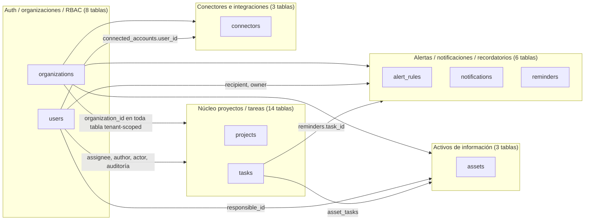
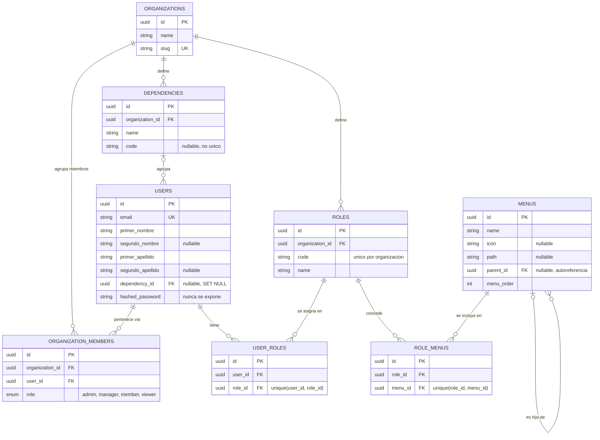
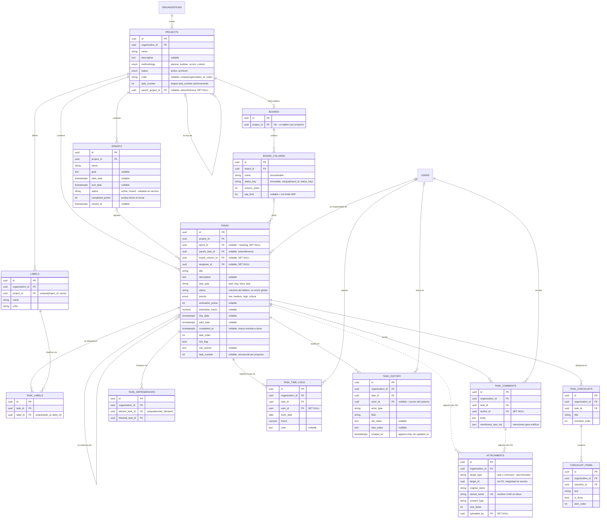
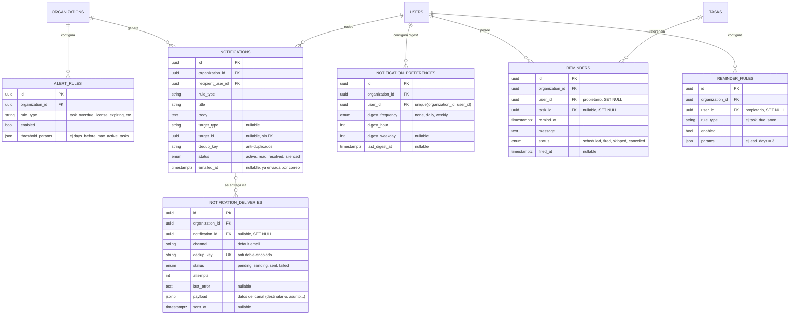
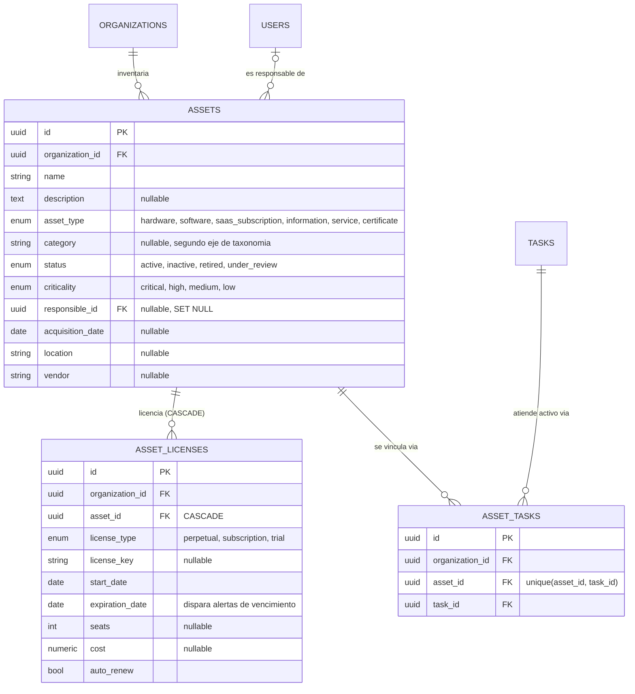
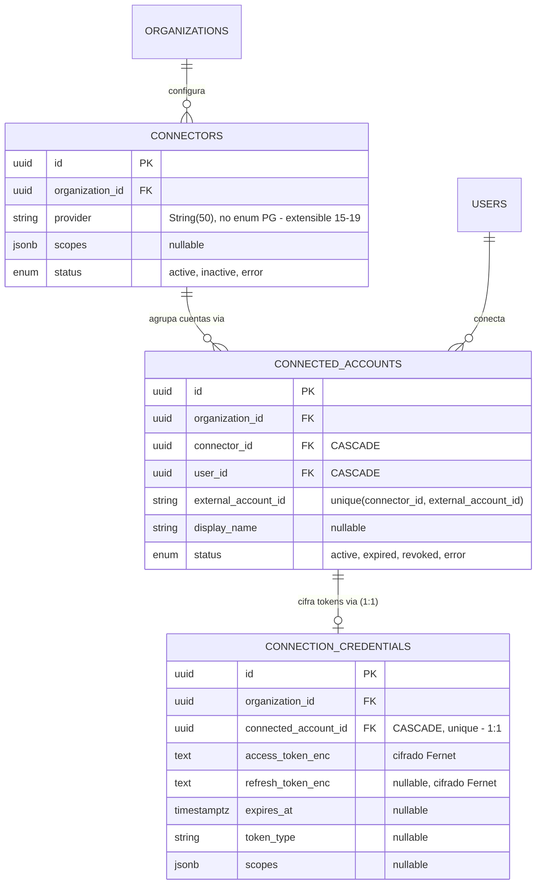

# Modelo entidad-relación — Solercia Project Manager

**Propósito**: este es el **documento vivo** del esquema de base de datos. Refleja, tabla por
tabla, los modelos SQLAlchemy reales de `backend/app/modules/*/models.py`,
`backend/app/notify/models.py` y los mixins de `backend/app/shared/base_model.py`. La fuente
de verdad es el **código**; este documento es su espejo navegable.

**Fecha de línea base**: 2026-07-18 (estado del código en la rama `feat/consume-solercia-ui`,
migraciones Alembic hasta `0015_add_connectors`).

> **Regla de actualización**: todo cambio de base de datos (modelo nuevo, columna nueva,
> enum nuevo, FK nueva o eliminada) debe actualizar este documento **en el mismo commit de la
> migración Alembic** que lo introduce. Un diagrama desactualizado es peor que ninguno.

> Nota: la imagen `docs/diagrams/erd.png` es una captura histórica anterior a esta línea base.
> Se conserva como referencia, pero **este archivo es la fuente viva** del diagrama.

**Total de tablas**: 34.

---

## Convenciones y mixins

Los modelos componen mixins de `app/shared/base_model.py`. Para no repetir columnas triviales
en cada bloque del diagrama, se omiten y se documentan aquí una sola vez:

| Mixin | Columnas que aporta | Notas |
|-------|---------------------|-------|
| `PkMixin` | `id uuid PK` | UUID generado en la aplicación. Todas las tablas lo usan. |
| `TimestampMixin` | `created_at`, `updated_at` (timestamptz) | Todas las tablas **excepto** `task_history` (append-only, define su propio `created_at`). |
| `SoftDeleteMixin` | `is_active bool`, `deleted_at timestamptz?` | Borrado lógico. No lo llevan las tablas pivote de borrado físico (`user_roles`, `role_menus`, `task_labels`, `asset_tasks`, `organization_members`) ni `notifications`, `notification_preferences`, `notification_deliveries`, `task_history`. |
| `TenantMixin` | `organization_id uuid FK → organizations` | Aislamiento multi-tenant por fila (`ondelete=CASCADE`). |
| `AuditMixin` | `created_by uuid? FK → users`, `updated_by uuid? FK → users` | `ondelete=SET NULL`; lo estampa el service desde el actor autenticado. Estas dos FK hacia `users` **no se dibujan** como aristas para no saturar el diagrama. |

Otras convenciones del esquema:

- Los enums se persisten como `VARCHAR` con `CHECK` (`native_enum=False`); en los diagramas
  se anotan como `enum` con sus valores.
- La columna lógica `order` se mapea a nombres físicos no reservados: `tasks.task_order`,
  `board_columns.column_order`, `task_checklists.checklist_order`, `checklist_items.item_order`,
  `menus.menu_order`.
- `tasks.status` es texto libre validado contra la metodología del proyecto (columnas del
  tablero), **no** un enum global.
- Las relaciones punteadas (`..`) indican vínculos lógicos sin FK física (validados en el
  service), como los destinos polimórficos de `attachments`.

---

## Vista general por dominios

Relaciones entre dominios (cada caja se detalla en su propia sección):

---

## Dominio 1 — Auth, organizaciones y RBAC

`organizations` es el tenant. `organization_members` da el **rol de tenant**
(`admin|manager|member|viewer`) que gobierna `require_role`. Aparte, `roles` + `user_roles` +
`role_menus` + `menus` forman el RBAC de navegación (el rol `ADMIN` habilita los endpoints
`/admin/*`). `dependencies` son áreas organizacionales (concepto distinto de
`task_dependencies` del dominio 2).

Notas del dominio:

- `users.full_name` **no es columna**: es una `hybrid_property` (`primer_nombre` +
  `primer_apellido`).
- `menus` es **global** (sin `organization_id`); lo que varía por organización es qué roles
  conceden cada menú.
- `roles` lleva `unique(organization_id, code)`.

---

## Dominio 2 — Núcleo de proyectos y tareas

`projects` se configura con una `methodology` (patrón Strategy). Cada proyecto tiene a lo sumo
**un** tablero (`boards.project_id` es `unique`) cuyas `board_columns` definen el `status`
que adopta la tarea al entrar en la columna (`status_key`). `tasks.status` sigue siendo el
campo validado; `board_column_id` es la fuente en runtime cuando hay tablero configurado.

Notas del dominio:

- `projects.parent_project_id` (change 21-project-hierarchy, migración `0014`) modela una
  jerarquía padre-hijo entre proyectos de la MISMA organización, mismo patrón de
  autoreferencia que `tasks.parent_task_id` (`SET NULL`, indexada). Cada subproyecto conserva
  su propia `methodology` (Strategy intacto); la jerarquía es puramente estructural. Validación
  de ciclos/profundidad máxima (`PROJECT_HIERARCHY_MAX_DEPTH`, por defecto 5) vive en el
  service, no en la base de datos.
- `task_dependencies` modela la arista dirigida canónica «`blocker` bloquea a `blocked`»;
  la vista inversa `is_blocked_by` se calcula, nunca es una segunda fila. Desvincular hace
  `is_active=false`, **nunca** DELETE físico (el DFS anti-ciclos filtra por `is_active`).
- `attachments` es polimórfica (`target_type` + `target_id`), por eso las aristas punteadas.
- `task_history` es append-only: sin `TimestampMixin`, sin soft delete; la fila **es** el
  registro de auditoría.
- `tasks.task_number` + `projects.code` forman la llave visible `task_key` (p. ej. `SDM-7`),
  asignada atómicamente vía `UPDATE ... RETURNING` sobre `projects.task_counter`.

---

## Dominio 3 — Alertas, notificaciones y recordatorios

`alert_rules` configura el motor de alertas por organización; el evaluador genera
`notifications` (in-app) con `dedup_key` anti-duplicados. `notification_preferences` guarda
la cadencia de digest de correo por usuario. `notification_deliveries` es el **outbox**
agnóstico de canal (hoy solo canal `email`). `reminders`/`reminder_rules` son recursos
estrictamente personales (ni un admin ve los de otra persona).

Notas del dominio:

- `notifications`, `notification_preferences` y `notification_deliveries` **no** llevan
  `SoftDeleteMixin`; las preferencias se *upsertean* en sitio (una fila por org+usuario).
- El `CHECK` del enum de `notification_deliveries.status` conserva el nombre histórico
  `email_outbox_status` (renombre de `email_outbox` en la migración `0013`).

---

## Dominio 4 — Activos de información (SDMujer)

Inventario de activos con licencias (composición: la licencia no sobrevive al activo) y
vínculo M:N a tareas existentes.

Notas del dominio:

- `asset_criticality` es un enum propio, deliberadamente **no** reutiliza `Priority` de
  tareas aunque los valores coincidan.
- `asset_tasks` diverge del precedente `task_labels`: lleva `organization_id` directo para
  filtrar por tenant sin join extra. Sin soft delete: desvincular borra la fila.

---

## Dominio 5 — Conectores e integraciones

Configuración de conectores OAuth por organización (change 14-integration-ports): `connectors`
es la config del proveedor (p. ej. Microsoft 365, Google, GLPI, Jira — adaptadores reales en
los cambios 15-19; esta ola solo registra un adaptador `fake` en memoria). `connected_accounts`
es la cuenta que un usuario conectó bajo ese proveedor — la unicidad es por
`external_account_id` **dentro del conector**, nunca por `(user_id, provider)`: un usuario
puede conectar varias cuentas del mismo proveedor (ej. dos buzones de correo). Los tokens
viven **aislados** en `connection_credentials` (1:1 con la cuenta, cifrados con Fernet),
nunca junto a los campos que la API expone directamente sobre `connected_accounts`. El
`state` OAuth (CSRF, single-use) vive en Redis con TTL, no en una tabla.

Notas del dominio:

- `connection_credentials` **no** lleva `SoftDeleteMixin`: es un hijo estrictamente
  1:1 (`ondelete=CASCADE`) de `connected_accounts` — desconectar una cuenta hace soft-delete
  de `ConnectedAccount` (respeta auditoría vía `SoftDeleteMixin`) y **DELETE físico (purga)** de
  `ConnectionCredentials` (postura conservadora de seguridad: los tokens cifrados no permanecen
  en la base tras la desconexión, incluso como borrados lógicos). Reconectar la misma cuenta
  externa reactiva la fila soft-deleted de la cuenta y guarda credenciales nuevas.
- El `state` OAuth (CSRF, anti-replay) NO es una tabla: vive en Redis
  (`oauth:state:{state}`, `SETEX`+`GETDEL` single-use) — decisión ratificada, TTL nativo sin
  necesidad de limpieza.
- `AccessContext` (contrato de `app/integrations/ports.py`, no persistido) transporta el
  token descifrado + `scopes` + un sink opcional `on_tokens_refreshed` para que un adaptador
  que rota tokens en una lectura los devuelva sin conocer la persistencia — lo consumen los
  adaptadores de los cambios 15/16 y el cambio 22.

---

## Módulos sin tablas propias

`auth`, `dashboard` y `search` no definen modelos: operan sobre las tablas anteriores
(autenticación sobre `users`/`organization_members`, vista ejecutiva y búsqueda global sobre
`projects`/`tasks`/`task_comments` con índices GIN de trigramas).

## Referencias

- `backend/app/shared/base_model.py` — mixins.
- `backend/app/shared/enums.py` — todos los enums del dominio.
- `backend/alembic/versions/` — historia de migraciones (fuente de la evolución del esquema).
- `docs/DATA-MODEL.md` — documento narrativo anterior (parcialmente desactualizado; ver este
  archivo para el estado real).
- `docs/diagrams/c4-architecture.md` — arquitectura C4 del sistema.
- `backend/app/integrations/` — núcleo hexagonal de puertos de integración (ports, registro,
  OAuth genérico, cifrado, state store).
