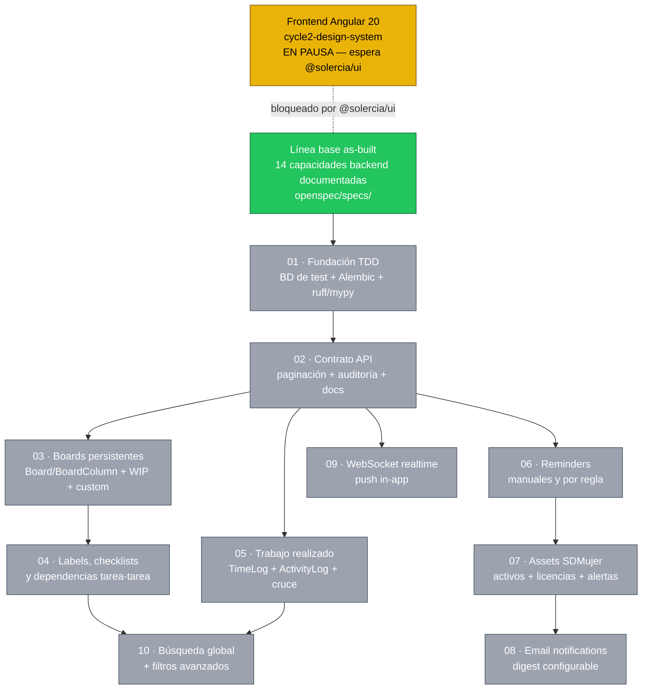

# Avance del plan — Solercia Project Manager

**Fuente del plan**: [CLAUDE.md](../CLAUDE.md) (prioridad de implementación, fases 1-4).
**Convención**: cada cambio futuro se ejecuta como un ciclo SDD completo en su propia carpeta `openspec/changes/NN-nombre/` (explore → proposal → spec → design → tasks → apply → verify → archive). El `state.yaml` de cada carpeta es la fuente de verdad de su estado. TDD estricto obligatorio (`strict_tdd: true` en [config.yaml](config.yaml); test command: `cd backend && pytest tests/ -v`). Lo YA construido está documentado como specs as-built en `openspec/specs/`.
**Última actualización**: 2026-07-11 (línea base as-built registrada: 14 specs; roadmap backend definido con 10 cambios pendientes; frontend EN PAUSA por la migración a @solercia/ui).

## Mapa visual del plan

**Leyenda**: 🟩 completado (línea base) · 🟨 en pausa/bloqueado · ⬜ pendiente

---

## Lo construido (línea base as-built, 2026-07-11)

Las 14 capacidades existentes están documentadas en `openspec/specs/`. Ninguna nació con ciclo SDD (son pre-SDD); sus escenarios Given/When/Then servirán para el backfill de tests.

| Capacidad | Spec | Estado de tests |
|-----------|------|-----------------|
| Autenticación (JWT + refresh cookie) | [specs/auth/spec.md](specs/auth/spec.md) | CERO tests |
| Administración de usuarios | [specs/users-admin/spec.md](specs/users-admin/spec.md) | CERO tests |
| Catálogo RBAC (roles + menús + áreas) | [specs/rbac-catalog/spec.md](specs/rbac-catalog/spec.md) | CERO tests |
| Multi-tenancy (row-level) | [specs/multi-tenancy/spec.md](specs/multi-tenancy/spec.md) | CERO tests |
| Proyectos | [specs/projects/spec.md](specs/projects/spec.md) | Solo velocity (indirecto) |
| Estrategias de metodología | [specs/methodology-strategies/spec.md](specs/methodology-strategies/spec.md) | CERO tests |
| Tareas | [specs/tasks/spec.md](specs/tasks/spec.md) | Parcial: by-key (13) + subtasks (4); CRUD/PATCH sin cubrir |
| Sprints | [specs/sprints/spec.md](specs/sprints/spec.md) | Parcial: close + velocity (8) |
| Comentarios y menciones | [specs/comments-mentions/spec.md](specs/comments-mentions/spec.md) | Cubierto: comments (6) + menciones (7) |
| Adjuntos | [specs/attachments/spec.md](specs/attachments/spec.md) | Cubierto: attachments (5) |
| Notificaciones in-app | [specs/notifications-inapp/spec.md](specs/notifications-inapp/spec.md) | Endpoints sin tests (creación por mención cubierta indirecto) |
| Motor de alertas | [specs/alert-engine/spec.md](specs/alert-engine/spec.md) | CERO tests |
| Vista ejecutiva | [specs/dashboard-executive/spec.md](specs/dashboard-executive/spec.md) | CERO tests |
| Convenciones de API | [specs/api-conventions/spec.md](specs/api-conventions/spec.md) | Sin tests transversales |

Total actual: **43 tests en 6 archivos** (`backend/tests/`).

---

## Roadmap de cambios backend

Todos pendientes. Cada uno se ejecutará como ciclo SDD completo (`openspec/changes/NN-nombre/`) con TDD estricto.

| # | Cambio | Alcance | Estado |
|---|--------|---------|--------|
| 01 | `01-fundacion-tdd` | Infraestructura de pruebas (BD `solercia_test` en docker-compose, fixtures compartidos en conftest, venv documentado); migración Alembic inicial descriptiva + adopción de Alembic como flujo (hoy el esquema se crea con `create_all`); ruff + mypy. **PRIORIDAD 1: desbloquea el TDD estricto de todo lo demás.** | ⬜ Pendiente |
| 02 | `02-contrato-api` | Paginación estándar (`?page&size&sort&order` + meta), auditoría `created_by`/`updated_by` automática, refresco del contrato (docs/API.md desactualizado: no lista comments, attachments, notifications, alert-rules, by-key, subtasks, velocity, close). | ⬜ Pendiente |
| 03 | `03-boards-persistentes` | Entidades Board/BoardColumn persistidas, `board_column_id` en Task, límites WIP (kanban), configuración de columnas en runtime (hoy la metodología custom es inutilizable: devuelve columnas vacías sin API para configurarlas). | ⬜ Pendiente |
| 04 | `04-labels-checklists-dependencias` | Label/TaskLabel, TaskChecklist/ChecklistItem, TaskDependency (blocks/is_blocked_by) + estrategia de alerta `blocked_task`. | ⬜ Pendiente |
| 05 | `05-trabajo-realizado` | TaskTimeLog + ActivityLog/TaskHistory + cruce "trabajo asignado vs realizado" en el dashboard ejecutivo (capacidad transversal clave del producto). | ⬜ Pendiente |
| 06 | `06-reminders` | Recordatorios manuales y automáticos por regla. | ⬜ Pendiente |
| 07 | `07-assets-sdmujer` | Asset + AssetLicense + AssetTask + estrategias de alerta `license_expiring`/`license_expired` (Fase 3 completa del CLAUDE.md). | ⬜ Pendiente |
| 08 | `08-email-notifications` | Canal email con digest configurable. | ⬜ Pendiente |
| 09 | `09-websocket-realtime` | Push in-app en tiempo real. | ⬜ Pendiente |
| 10 | `10-busqueda-global` | Búsqueda global + filtros avanzados. | ⬜ Pendiente |

---

## Frontend — EN PAUSA

- El ciclo [changes/cycle2-design-system/](changes/cycle2-design-system/) (sistema de diseño del frontend Angular 20) está **ON-HOLD**: proposal y design completos, tasks parcial (Fases 0-1 ejecutadas).
- **Bloqueante**: la migración a la librería compartida `@solercia/ui`, descrita en [docs/PLAN_MIGRACION_SOLERCIA_UI.md](../docs/PLAN_MIGRACION_SOLERCIA_UI.md). En solercia_flows corresponde al programa **07 · Súper Front @sol/ui (E0–E7)**.
- **Regla dura**: ningún cambio SDD debe tocar `frontend/` hasta levantar el bloqueo (constraint `frontend-frozen` en config.yaml).

---

## Deuda transversal detectada (2026-07-11)

- **Cero migraciones Alembic**: el esquema se crea con `Base.metadata.create_all` en startup + seed en `db_init` (Alembic instalado, ninguna revisión).
- **Sin paginación**: todas las listas devuelven todo; `meta.total = len`.
- **Sin auditoría `created_by`/`updated_by`** en ningún modelo.
- **Solo 43 tests en 6 archivos**. Módulos con CERO tests: auth, users, organizations, projects (CRUD), roles, menus, dependencies, dashboard, endpoints de alert_rules y notifications, motor de alertas completo, estrategias de metodología.
- **Tests de integración frágiles**: requieren `TEST_DATABASE_URL` (se saltan sin ella) y la BD `solercia_test` NO existe en docker-compose.
- **Sin ruff ni mypy** (cero linting/type-checking).
- **Documentación desactualizada**: docs/API.md y docs/METHODOLOGY-FEATURES.md no reflejan el código actual.
- **Permisos granulares por endpoint (viewer/manager/member) mayormente no aplicados**; conviven dos sistemas de roles paralelos (MemberRole vs catálogo RBAC).
- **TODO de lock distribuido Redis** en el evaluador de alertas (REDIS_URL declarado y sin uso).
