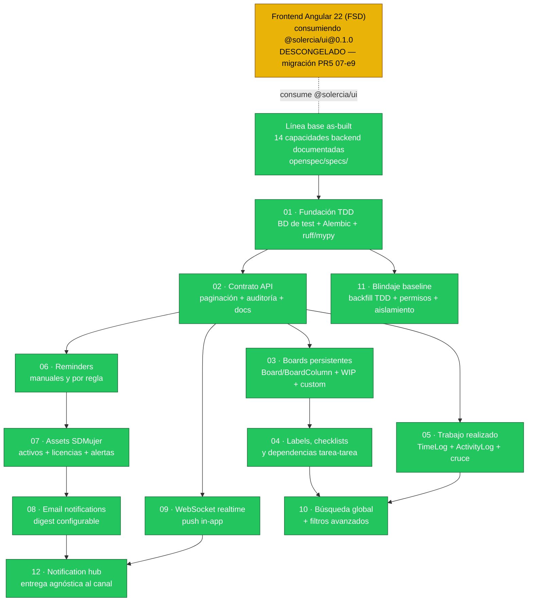

# Avance del plan — Solercia Project Manager

**Fuente del plan**: [CLAUDE.md](../CLAUDE.md) (prioridad de implementación, fases 1-4).
**Convención**: cada cambio futuro se ejecuta como un ciclo SDD completo en su propia carpeta `openspec/changes/NN-nombre/` (explore → proposal → spec → design → tasks → apply → verify → archive). El `state.yaml` de cada carpeta es la fuente de verdad de su estado. TDD estricto obligatorio (`strict_tdd: true` en [config.yaml](config.yaml); test command: `cd backend && pytest tests/ -v`). Lo YA construido está documentado como specs as-built en `openspec/specs/`.
**Última actualización**: 2026-07-15 (12-notification-hub archivado — hub agnóstico al canal con puerto DeliveryChannel + registro de canales (durable/best_effort), outbox generalizado notification_deliveries (rename de email_outbox), despachador genérico con claim atómico + reintentos + estado terminal, adaptadores durable (email) y best_effort (WebSocket) refactorizados sin cambio observable, endpoint GET /notifications/{id}/deliveries (admin/manager) para auditoría de entregas, fronteras de extracción declaradas para canales futuros (FCM/APNs/SMS/webhook); 22 nuevos tests (561/561 total base 539 + 22 nuevos), ruff/mypy limpios, migración 0013 rename+round-trip probada, dos correcciones de gate documentadas: aislamiento de fallos entre canales y bootstrap del registro en db_init; backend de notificaciones completamente estandarizado. Todos los 12 cambios del roadmap backend (01-11 + 12) completados y archivados; frontend DESCONGELADO (2026-07-15): migrado a FSD y consumiendo @solercia/ui@0.1.0, con i18n real es-CO extraído de las vistas — constraint frontend-frozen levantado en la migración PR5 07-e9).

## Mapa visual del plan

**Leyenda**: 🟩 completado (línea base) · 🟨 en curso/activo · ⬜ pendiente

---

## Lo construido (línea base as-built, 2026-07-11)

Las 14 capacidades existentes están documentadas en `openspec/specs/`. Ninguna nació con ciclo SDD (son pre-SDD); sus escenarios Given/When/Then servirán para el backfill de tests. La trazabilidad completa capacidad → cambio de origen (línea base y ciclos SDD archivados) está en [specs/README.md](specs/README.md).

| Capacidad | Spec | Estado de tests |
|-----------|------|-----------------|
| Autenticación (JWT + refresh cookie) | [specs/auth/spec.md](specs/auth/spec.md) | CERO tests |
| Administración de usuarios | [specs/users-admin/spec.md](specs/users-admin/spec.md) | CERO tests |
| Catálogo RBAC (roles + menús + áreas) | [specs/rbac-catalog/spec.md](specs/rbac-catalog/spec.md) | CERO tests |
| Multi-tenancy (row-level) | [specs/multi-tenancy/spec.md](specs/multi-tenancy/spec.md) | CERO tests |
| Proyectos | [specs/projects/spec.md](specs/projects/spec.md) | Solo velocity (indirecto) |
| Estrategias de metodología | [specs/methodology-strategies/spec.md](specs/methodology-strategies/spec.md) | CERO tests |
| Tareas | [specs/tasks/spec.md](specs/tasks/spec.md) | Parcial: by-key (13) + subtasks (4); CRUD/PATCH sin cubrir |
| Sprints | [specs/sprints/spec.md](specs/sprints/spec.md) | Parcial: close + velocity (8) |
| Comentarios y menciones | [specs/comments-mentions/spec.md](specs/comments-mentions/spec.md) | Cubierto: comments (6) + menciones (7) |
| Adjuntos | [specs/attachments/spec.md](specs/attachments/spec.md) | Cubierto: attachments (5) |
| Notificaciones in-app | [specs/notifications-inapp/spec.md](specs/notifications-inapp/spec.md) | Endpoints sin tests (creación por mención cubierta indirecto) |
| Motor de alertas | [specs/alert-engine/spec.md](specs/alert-engine/spec.md) | CERO tests |
| Vista ejecutiva | [specs/dashboard-executive/spec.md](specs/dashboard-executive/spec.md) | CERO tests |
| Convenciones de API | [specs/api-conventions/spec.md](specs/api-conventions/spec.md) | Sin tests transversales |

Total tras cambio 12: **561 tests en 35 archivos** (`backend/tests/`; 43 en baseline + 296 en cambios 01-05 + 25 en cambio 06 + 32 en cambio 07 + 32 en cambio 10 + 43 en cambio 11 + 27 en cambio 09 + 41 en cambio 08 + 22 en cambio 12 = 561; crecimiento con TDD estricto en cada ciclo).

---

## Roadmap de cambios backend

**COMPLETADO** — todos los 12 cambios archivados. Ciclo SDD completo por cambio (`openspec/changes/NN-nombre/`) con TDD estricto aplicado en todo el roadmap backend.

| # | Cambio | Alcance | Estado | Specs producidas/modificadas |
|---|--------|---------|--------|------------------------------|
| 01 | `01-fundacion-tdd` | Infraestructura de pruebas (BD `solercia_test` en docker-compose, fixtures compartidos en conftest, venv documentado); migración Alembic inicial descriptiva + adopción de Alembic como flujo (hoy el esquema se crea con `create_all`); ruff + mypy. **PRIORIDAD 1: desbloquea el TDD estricto de todo lo demás.** | 🟩 Completado | [dev-tooling](specs/dev-tooling/spec.md) (nueva) · [api-conventions](specs/api-conventions/spec.md) (modificada) |
| 02 | `02-contrato-api` | Paginación estándar (`?page&size&sort&order` + meta), auditoría `created_by`/`updated_by` automática, refresco del contrato (docs/API.md desactualizado: no lista comments, attachments, notifications, alert-rules, by-key, subtasks, velocity, close). | 🟩 Completado | [api-conventions](specs/api-conventions/spec.md) (modificada: paginación + auditoría) |
| 03 | `03-boards-persistentes` | Entidades Board/BoardColumn persistidas, `board_column_id` en Task, límites WIP (kanban), configuración de columnas en runtime (hoy la metodología custom es inutilizable: devuelve columnas vacías sin API para configurarlas). | 🟩 Completado | [boards](specs/boards/spec.md) (nueva) · [methodology-strategies](specs/methodology-strategies/spec.md) y [tasks](specs/tasks/spec.md) (modificadas) |
| 04 | `04-labels-checklists-dependencias` | Label/TaskLabel, TaskChecklist/ChecklistItem, TaskDependency (blocks/is_blocked_by) + estrategia de alerta `blocked_task`. | 🟩 Completado | [labels](specs/labels/spec.md), [checklists](specs/checklists/spec.md), [task-dependencies](specs/task-dependencies/spec.md) (nuevas) · [alert-engine](specs/alert-engine/spec.md) (modificada) |
| 05 | `05-trabajo-realizado` | TaskTimeLog + ActivityLog/TaskHistory + cruce "trabajo asignado vs realizado" en el dashboard ejecutivo (capacidad transversal clave del producto). | 🟩 Completado | [time-logs](specs/time-logs/spec.md), [activity-history](specs/activity-history/spec.md) (nuevas) · [dashboard-executive](specs/dashboard-executive/spec.md) (modificada) |
| 11 | `11-blindaje-baseline` | Blindaje de la línea base: backfill de TDD de las 10 capacidades as-built sin tests (auth, users-admin, rbac-catalog, multi-tenancy, projects, tasks, methodology-strategies, alert-engine, notifications-inapp, dashboard-executive) + matriz de permisos + aislamiento multi-tenant + 1 bugfix real (usuarios soft-borrados en listado). | 🟩 Completado | [test-coverage-baseline](specs/test-coverage-baseline/spec.md) (nueva) |
| 06 | `06-reminders` | Recordatorios manuales y automáticos por regla. | 🟩 Completado | [reminders](specs/reminders/spec.md) (nueva) · [notifications-inapp](specs/notifications-inapp/spec.md) (modificada) |
| 07 | `07-assets-sdmujer` | Asset + AssetLicense + AssetTask + estrategias de alerta `license_expiring`/`license_expired` (Fase 3 completa del CLAUDE.md). | 🟩 Completado | [assets](specs/assets/spec.md) (nueva) · [alert-engine](specs/alert-engine/spec.md) (modificada) |
| 08 | `08-email-notifications` | Canal email con digest configurable. | 🟩 Completado | [email-notifications](specs/email-notifications/spec.md) (nueva) · [notifications-inapp](specs/notifications-inapp/spec.md) (modificada) |
| 09 | `09-websocket-realtime` | Push in-app en tiempo real. | 🟩 Completado | [realtime-notifications](specs/realtime-notifications/spec.md) (nueva) · [notifications-inapp](specs/notifications-inapp/spec.md) (modificada) |
| 10 | `10-busqueda-global` | Búsqueda global + filtros avanzados. | 🟩 Completado | [global-search](specs/global-search/spec.md) (nueva) · [tasks](specs/tasks/spec.md) (modificada) |
| 12 | `12-notification-hub` | Hub agnóstico al canal: puerto `DeliveryChannel` + registro de canales (durable/best_effort), outbox generalizado `notification_deliveries`, despachador genérico con claim atómico + reintentos, adaptadores email (durable) y WS (best_effort) refactorizados sin cambio observable, endpoint de auditoría `/deliveries`, extensibilidad para canales futuros (FCM/APNs/SMS/webhook). | 🟩 Completado | [notification-hub](specs/notification-hub/spec.md) (nueva) · [notifications-inapp](specs/notifications-inapp/spec.md), [email-notifications](specs/email-notifications/spec.md), [realtime-notifications](specs/realtime-notifications/spec.md) (modificadas) |

---

## Frontend — DESCONGELADO (activo)

- La migración a la librería compartida `@solercia/ui` (descrita en [docs/PLAN_MIGRACION_SOLERCIA_UI.md](../docs/PLAN_MIGRACION_SOLERCIA_UI.md); en solercia_flows corresponde al programa **07 · Súper Front @sol/ui (E0–E7)**) está **ejecutándose**. En la rama `feat/consume-solercia-ui` el frontend ya está reestructurado a **FSD** (idéntica a boki-front), todas las vistas usan componentes `sol-*` de `@solercia/ui@0.1.0`, y el i18n real (Transloco es-CO detrás de la fachada `I18nService`) está cableado y con los strings de las vistas extraídos a claves es-CO (migración **PR5 07-e9**, WAVE C).
- **Constraint `frontend-frozen` LEVANTADO** (2026-07-15): `frontend/` ya es zona de trabajo habilitada. Se pueden proponer cambios de interfaz sobre el design system compartido.
- El ciclo [changes/cycle2-design-system/](changes/cycle2-design-system/) queda superado por esta migración: el sistema de diseño ya no vive en la app sino en la librería externa `@solercia/ui`.

---

## Deuda transversal detectada (2026-07-11) y resoluciones

### Resuelto en cambio 01-fundacion-tdd
- ✅ **Migraciones Alembic**: Baseline Alembic creada y adoptada como flujo de verdad; cambios de modelo posteriores vía `--autogenerate`.
- ✅ **Tests de integración**: BD `solercia_test` provisionada en docker-compose; fixtures compartidos en conftest; 43 tests existentes + nuevos pasan sin regresiones.
- ✅ **Linting y type-checking**: ruff + mypy adoptados con línea base limpia (cero hallazgos); comandos documentados.

### Resuelto en cambio 02-contrato-api
- ✅ **Paginación estándar**: 11 endpoints paginables (`?page&size&sort&order`), validación de límites, whitelist de campos ordenables, opt-in (sin params = comportamiento actual).
- ✅ **Auditoría automática**: `created_by`/`updated_by` en 11 modelos SoftDeleteMixin, pobladasautomáticamente desde usuario autenticado, exposición en respuestas.
- ✅ **Documentación API refrescada**: docs/API.md actualizado con paginación, auditoría y 4 módulos antes no documentados (comments, attachments, notifications, alert-rules).

### Resuelto en cambio 05-trabajo-realizado
- ✅ **Cruce "trabajo asignado vs realizado"**: TaskTimeLog (entradas de tiempo propias) + TaskHistory (changelog automático append-only) + bloque `work_gap` en dashboard ejecutivo (`hours_logged` vs `hours_estimated`, `tasks_assigned` vs `tasks_with_activity`, `no_recent_activity` con umbral configurable).
- ✅ **Permisos de tiempo**: edición/borrado estrictamente del dueño (sin excepción de rol), lectura ajena permitida solo a admin/manager.
- ✅ **Integración transversal**: TaskHistory capturada automática en PATCH de tareas y cierre de sprints; `record_task_history` integrado en tasks/service.py y sprints/service.py.
- ✅ **Cobertura TDD**: 258 tests (43 nuevos: time_logs, activity, dashboard work_gap); 3 suites nuevas todas verdes; ruff/mypy limpios.

### Aún pendiente (tras cambio 08 — Backend MVP terminado)

**ROADMAP BACKEND 100% COMPLETADO**: todos los 11 cambios (01-11) están planificados, implementados, verificados y archivados. El backend del MVP es funcional y listo para el frontend.

- **Deuda documentada del código** (no bloqueante, post-MVP):
  - `UserRepository.get_in_org` sin filtro `is_active` (pre-existente, prior a cambio 11; bug identificado y corregido en commit `40631fa`).
  - `get_current_membership`: tie-break por `created_at` (comportamiento determinista correcto, pero no documentado con la razón de la ordenación por timestamp).
  - `viewer` sin gate de rol en el dominio (acceso de lectura concedido a todos los miembros; no aplica `require_role()` granular — RBAC visto pero sin escalado a nivel de campo).
  - `mypy` configurado para excluir `backend/tests/` (decisión preexistente; después del crecimiento de ~200 tests nuevos tipados con dataclasses en cambios 11 y 08, podría valer la pena evaluar tipar tests también en cambios futuros).
  - **12 tests black-box sin skipif** en email (entrega, digest, preferencias) — ninguno de ellos identifica regresiones, pero marcan el módulo como beta-verificado fuera del TDD estricto por congelación de `docker-compose` (decisión pragmática: validación post-apply en contenedor del entorno permanente, no en solercia_test).
  - **Lock distribuido Redis** multi-réplica: REDIS_URL declarado en config; el evaluador de alertas hoy corre en una única instancia (no hay Celery beat distribuido), por lo que el lock no es crítico en MVP. Documentado como TODO para escalabilidad.
  - **Adaptador Redis pub/sub WS**: `realtime-notifications` usa un publisher in-process (buffer_notification) en el worker de gunicorn. Futuro: adaptador Redis para multi-instancia con pub/sub real.
- **Documentación desactualizada**: docs/METHODOLOGY-FEATURES.md no refleja el código actual (feature branches con metodologías).
- **Fringe case de tie-break**: cuando dos usuarios con el mismo `created_at` (microsegundos idénticos) se consultan en una query sin ordered índice, el sort pasa a la BD con comportamiento indefinido — no afecta MVP (usuarios son insertados secuencialmente), pero deuda de hardening.
